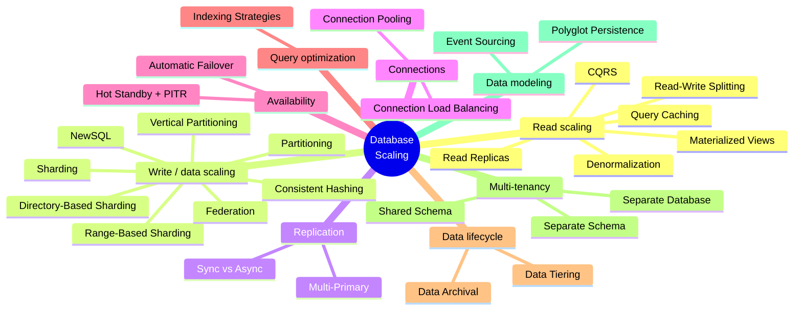

# Database Scaling Patterns

## Tech Stack

- **Programming Language**: Go 1.26.0
- **Container**: Docker Compose
- **Database**: PostgreSQL 18 (plus CockroachDB v26.2 for NewSQL, Redis 8 for caching, Elasticsearch 9.1 and HAProxy 3.2 where noted)

## Pattern Map

## Projects

- **[simulate_database_partitioning](./simulate_database_partitioning)** - Demonstrates PostgreSQL table partitioning strategies
- **[simulate_database_sharding](./simulate_database_sharding)** - Demonstrates database sharding across multiple PostgreSQL instances
- **[simulate_read_replicas](./simulate_read_replicas)** - Primary + streaming replicas: read scaling, replication lag, read-your-writes
- **[simulate_connection_pooling](./simulate_connection_pooling)** - PgBouncer multiplexing many clients onto a few PostgreSQL connections
- **[simulate_query_caching](./simulate_query_caching)** - Redis cache-aside with TTL, write-through, and invalidation
- **[simulate_read_write_splitting](./simulate_read_write_splitting)** - Application-level router sending writes to the primary and reads to replicas
- **[simulate_consistent_hashing](./simulate_consistent_hashing)** - Hash ring with virtual nodes: minimal data movement on resize vs modulo sharding
- **[simulate_cqrs](./simulate_cqrs)** - Command Query Responsibility Segregation: normalized write store + denormalized read store via a projector
- **[simulate_automatic_failover](./simulate_automatic_failover)** - Health-checked failover manager promoting a standby with pg_promote()
- **[simulate_multitenancy_shared_schema](./simulate_multitenancy_shared_schema)** - Shared schema multi-tenancy isolated with PostgreSQL Row-Level Security
- **[simulate_event_sourcing](./simulate_event_sourcing)** - Append-only event log: state reconstruction by replay, snapshots, optimistic concurrency
- **[simulate_newsql](./simulate_newsql)** - 3-node CockroachDB cluster: distributed ACID transactions, auto-sharding/replication, fault tolerance
- **[simulate_data_tiering](./simulate_data_tiering)** - Hot/warm/cold storage tiers via partitioning + tablespaces with age-based migration
- **[simulate_multi_primary_replication](./simulate_multi_primary_replication)** - Two writable nodes with bidirectional logical replication: conflict avoidance, divergence, last-writer-wins
- **[simulate_sync_async_replication](./simulate_sync_async_replication)** - Async vs synchronous commit levels, blocked commits, and quorum (`ANY n`) replication
- **[simulate_materialized_views](./simulate_materialized_views)** - Precomputed aggregates: on-demand, concurrent, periodic, and incremental (MERGE) refresh
- **[simulate_connection_load_balancing](./simulate_connection_load_balancing)** - HAProxy write/read endpoints with health checks, failover to backup, and recovery
- **[simulate_directory_based_sharding](./simulate_directory_based_sharding)** - Lookup-service sharding: dynamic placement, moving a hot tenant, stale-cache fencing
- **[simulate_range_based_sharding](./simulate_range_based_sharding)** - Date-range shards: range-query pruning, write hotspots, splitting and rebalancing
- **[simulate_vertical_partitioning](./simulate_vertical_partitioning)** - Splitting a wide table into hot, cold and BLOB tables: pages read, bytes shipped, WAL written
- **[simulate_denormalization](./simulate_denormalization)** - Redundant columns kept in sync by triggers: read speedups, write fan-out, drift and reconciliation
- **[simulate_federation](./simulate_federation)** - Database per domain: app-side joins, postgres_fdw pushdown, and lost foreign keys
- **[simulate_hot_standby](./simulate_hot_standby)** - Hot vs warm (log-shipping) standby, WAL archiving, and point-in-time recovery
- **[simulate_indexing_strategies](./simulate_indexing_strategies)** - B-tree, Hash, GIN, GiST, BRIN, partial, covering and expression indexes; bloat and unused indexes
- **[simulate_data_archival](./simulate_data_archival)** - Batched archiving to a cold-tuned table, retrieval strategies, and compressed exports
- **[simulate_multitenancy_separate_schema](./simulate_multitenancy_separate_schema)** - Schema per tenant with per-tenant roles, migrations, backup, and catalog growth
- **[simulate_multitenancy_separate_database](./simulate_multitenancy_separate_database)** - Database per tenant: per-database limits, moving tenants between servers, connection explosion
- **[simulate_polyglot_persistence](./simulate_polyglot_persistence)** - PostgreSQL + Redis + Elasticsearch kept in sync with a transactional outbox
