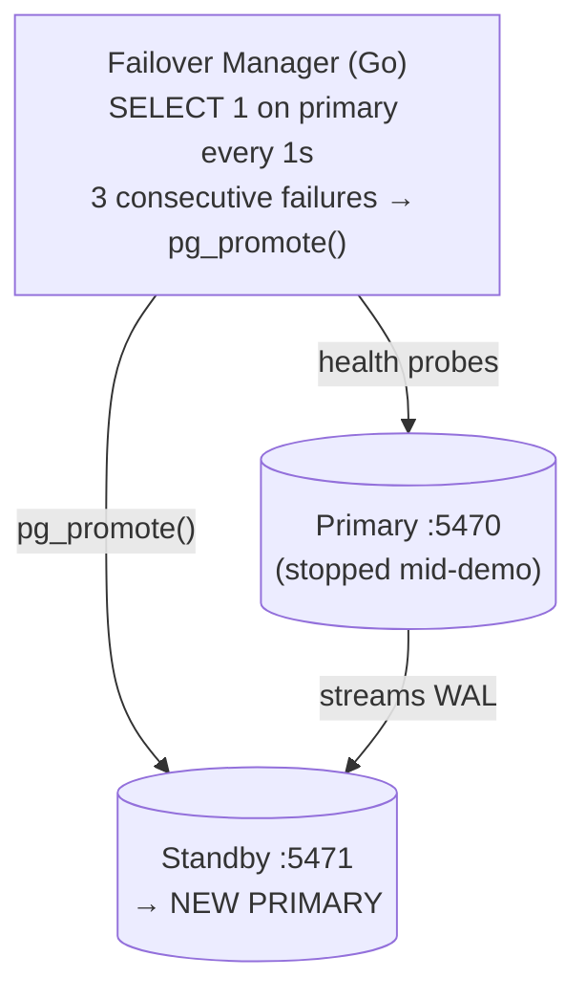
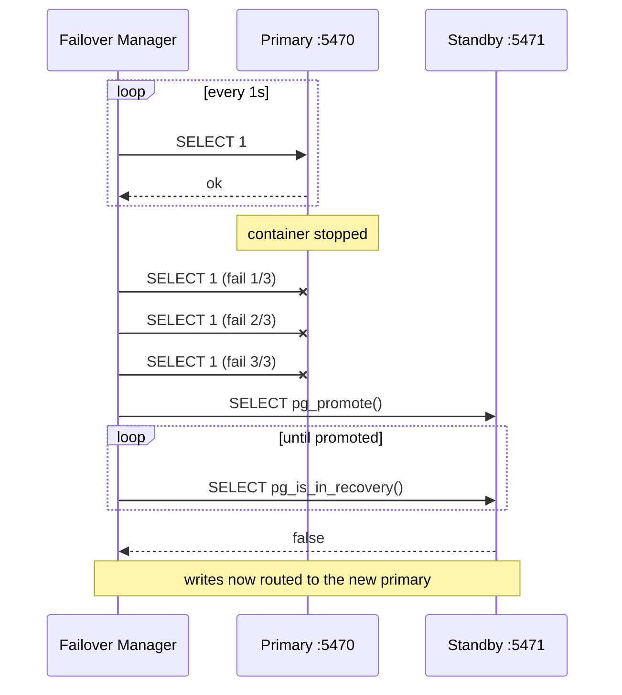

# Simulate Automatic Failover Using Docker

## Tech Stack

- **Programming Language**: Go 1.26.0
- **Container**: Docker Compose
- **Database**: PostgreSQL 18 (1 primary + 1 hot standby)

## Overview

**Automatic failover** keeps a database available when the primary dies: a manager
detects the outage and **promotes a standby** to take over as the new primary,
then redirects writes to it. This project implements the core control loop — health
probing, a failure threshold, and `pg_promote()` — in ~150 lines so the mechanism
is explicit. Production tools (**Patroni**, **repmgr**, **pg_auto_failover**) wrap
this with distributed leader election and fencing.

The demo actually **stops the primary container** mid-run, so you watch a real
outage get detected and recovered with no data loss.

> Related project: [`simulate_read_replicas`](../simulate_read_replicas) sets up
> the same primary/standby streaming replication. Here the focus is what happens
> when the primary **fails**.

### Key Concepts Demonstrated

1. **Health checking** — periodic `SELECT 1` probes with a timeout.
2. **Failure threshold** — fail over only after N consecutive misses (avoid flapping).
3. **Promotion** — `pg_promote()` makes the standby writable; wait for `pg_is_in_recovery() = false`.
4. **Write redirection** — the manager routes writes to the promoted node.
5. **No data loss** — rows written before the crash survive on the promoted node.

### Architecture





## How to Run

```bash
docker compose up -d      # primary + standby (standby clones via pg_basebackup)
docker compose ps         # wait until both healthy
go mod tidy
go run main.go            # the program stops the primary container itself
```

> The program calls `docker stop failover_primary` to simulate the crash. If your
> user can't run docker without sudo, the program prints the command to run
> manually in another terminal.

## Expected Output

A row is written and replicated to the standby. The manager then stops the primary,
its health probes start failing, and after 3 misses it promotes the standby. A
post-failover write succeeds on the new primary, and the final count includes both
pre- and post-failover rows — proving no data was lost.

## Restore After the Demo

```bash
docker compose up -d postgres_primary   # bring the old node back (now a stale ex-primary)
# In production you'd re-clone it as a standby of the new primary (pg_rewind / pg_basebackup).
docker compose down -v                  # or wipe everything
```

## A Note on Split-Brain

If the old primary comes back still thinking it's the primary, you have **two
writable nodes** = split-brain and divergent data. Real HA tools prevent this with
**fencing** (STONITH), a **distributed consensus store** (etcd/Consul) for a single
source of truth on who is leader, and **quorum** so a minority partition won't
promote itself. This demo omits fencing for clarity — don't ship it as-is.

## Cleanup

```bash
docker compose down -v
```
