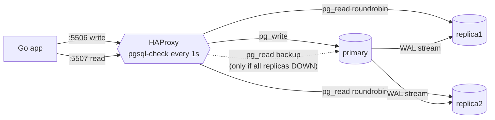

# Simulate Connection Load Balancing Using Docker

## Tech Stack

- **Programming Language**: Go 1.26.0
- **Container**: Docker Compose
- **Database**: PostgreSQL 18 (primary + 2 streaming replicas)
- **Load balancer**: HAProxy 3.2 (LTS)

## Overview

With several database servers, clients need to know which one to connect to — and to
stop using one that dies. A **connection load balancer** solves both: clients connect
to one stable address, and the balancer forwards each new connection to a healthy
backend chosen by its algorithm and health checks.

This project puts **HAProxy** in front of a primary and two read replicas and exposes
the two endpoints most PostgreSQL HA setups use: a **write** port (primary only) and a
**read** port (replicas, with the primary as a backup).

### Key Concepts Demonstrated

1. **Write / read endpoints** — `:5506` → primary, `:5507` → replicas.
2. **Round-robin** — new connections alternate between replicas.
3. **Per-connection balancing** — a connection pool keeps using the backends it first
   connected to; HAProxy never sees individual queries.
4. **Health checks** — `option pgsql-check` + `inter 1s fall 2` removes a stopped
   replica within ~2 s; `on-marked-down shutdown-sessions` kills its sessions.
5. **Backup server** — when every replica is down, reads fall back to the primary.
6. **Automatic recovery** — `rise 2` puts restarted replicas back in rotation.

### Architecture



## How to Run

```bash
docker compose up -d --wait
go mod tidy
go run main.go
```

The program stops and restarts replica containers with `docker stop/start` to simulate
failures. Watch it live on the HAProxy dashboard: <http://localhost:8404/stats>.

## Expected Output (abridged)

```
🔄 ROUND-ROBIN — 10 new connections to the read endpoint
   replica1               █████ 5
   replica2               █████ 5
📌 POOLED CONNECTIONS — balancing happens per CONNECTION, not per query
   replica1 (pid 68)      ██████████ 10
   replica2 (pid 68)      ██████████ 10
💥 FAILURE — stop replica1, HAProxy health check marks it DOWN
   HAProxy pg_read: 🟢 primary UP   🔴 replica1 DOWN   🟢 replica2 UP
   replica2               ██████ 6
🛟 ALL REPLICAS DOWN — the primary 'backup' server takes reads
   primary                ███ 3
♻️  RECOVERY — replicas restarted, rise 2 → back in rotation
   replica1               ███ 3
   replica2               ███ 3
```

## Load Balancer Options

| Option              | Layer | Knows SQL? | Notes                                                     |
| ------------------- | ----- | ---------- | --------------------------------------------------------- |
| **HAProxy**         | TCP   | No         | Fast, simple, rich health checks; pair with Patroni REST  |
| **pgpool-II**       | SQL   | Yes        | Can split reads/writes per query; more complex, heavier   |
| **PgBouncer**       | SQL   | Partly     | A pooler, not a balancer — often sits next to HAProxy     |
| **Cloud LB / DNS**  | TCP   | No         | Managed; DNS failover is slow (TTL caching)               |
| **libpq multi-host**| client| No         | `host=a,b,c target_session_attrs=read-write` — no proxy   |

## Trade-offs

| Benefit                                       | Cost                                                   |
| --------------------------------------------- | ------------------------------------------------------ |
| One stable address; topology hidden           | Extra network hop; the balancer itself must be HA      |
| Failed backends removed automatically         | Detection takes `inter × fall`; in-flight sessions drop |
| Easy to add replicas                          | Balancing is per connection — pools can stay skewed    |
| No application changes                        | TCP balancer can't route by query (reads vs writes)    |

## When to Use

- You run read replicas and want clients to use all of them without hard-coding hosts.
- You want failed nodes taken out of rotation without redeploying clients.

Run two HAProxy instances (keepalived VIP or a cloud LB in front) in production, so the
balancer isn't a single point of failure.

## Notes on "not outdated"

- HAProxy 3.2 LTS with `resolvers` for Docker DNS and `init-addr last,libc,none`.
- `option pgsql-check` (not a bare TCP check); docs point to Patroni REST checks
  (`httpchk GET /primary`) for role-aware routing after failover.
- Go 1.26: `slices.Sorted(maps.Keys(...))`, `sync.WaitGroup.Go`.

## Cleanup

```bash
docker compose down -v
```
