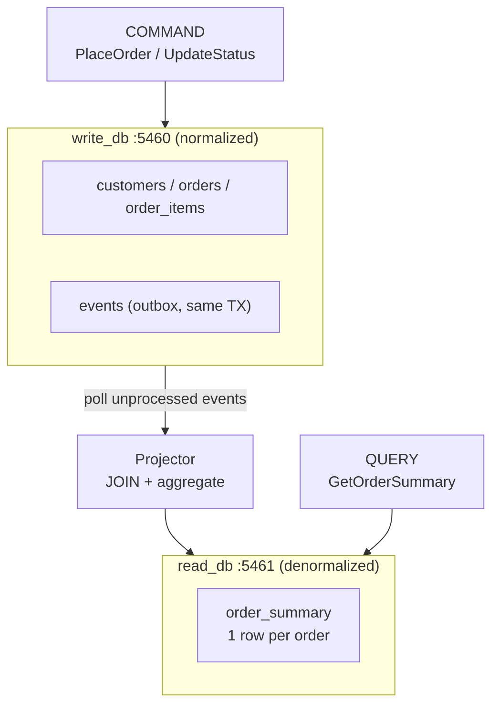

# Simulate CQRS Using Docker

## Tech Stack

- **Programming Language**: Go 1.26.0
- **Container**: Docker Compose
- **Database**: PostgreSQL 18 (separate write store + read store)

## Overview

**CQRS** (Command Query Responsibility Segregation) splits a system into two
models that are optimized independently:

- **Commands** (writes) hit a **normalized** write store — one fact in one place,
  enforced with foreign keys and transactions.
- **Queries** (reads) hit a **denormalized** read store — pre-joined,
  pre-aggregated rows answered with a single-row lookup.

The two stores are kept in sync **asynchronously** by a **projector** that drains
a transactional **outbox** on the write side. That makes reads _eventually
consistent_: a just-committed write is invisible to queries until the projector
runs — and this project shows exactly that window.

> Related projects: [`simulate_read_write_splitting`](../simulate_read_write_splitting)
> splits reads/writes across copies of the _same_ model; CQRS splits them across
> _different_ models. [`simulate_query_caching`](../simulate_query_caching) is a
> simpler form of the same read-optimization idea.

### Key Concepts Demonstrated

1. **Command/Query separation** — different code paths, different schemas.
2. **Transactional outbox** — events written atomically with the data.
3. **Projection** — rebuild denormalized read rows from normalized events.
4. **Eventual consistency** — query before vs after projection.

### Architecture



## How to Run

```bash
docker compose up -d      # write store + read store
docker compose ps         # wait until both healthy
go mod tidy
go run main.go
```

## Expected Output

A placed order is immediately queryable on the write store but **absent** from the
read model until the projector runs. After projection, the query returns a single
denormalized row (customer name, item count, total). A status change repeats the
cycle: stale read → project → fresh read.

## CQRS Trade-offs

| Aspect            | Benefit                              | Cost                                  |
| ----------------- | ------------------------------------ | ------------------------------------- |
| **Read speed**    | Single-row lookups, no JOINs         | Read model is derived/duplicated data |
| **Write clarity** | Normalized, transactional            | Two schemas to maintain               |
| **Scaling**       | Scale reads and writes independently | Projector is extra moving infra       |
| **Consistency**   | Tunable, async                       | Reads are eventually consistent       |

## Cleanup

```bash
docker compose down -v
```
