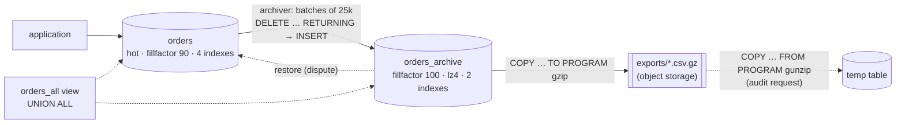

# Simulate Data Archival Using Docker

## Tech Stack

- **Programming Language**: Go 1.26.0
- **Container**: Docker Compose
- **Database**: PostgreSQL 18 (single instance + an export directory standing in for object storage)

## Overview

Most tables accumulate rows that are no longer part of daily work — delivered orders
from two years ago — but still have to be kept. Left in place they make the hot table,
its indexes, vacuum, backups and cache footprint grow forever. **Data archival** moves
them out, in stages, while keeping a way to get them back:

```
hot table  ──►  archive table (same DB, cold-tuned)  ──►  compressed files (object storage)
 fast            slower, cheaper                            slowest, cheapest
```

Where [`simulate_data_tiering`](../simulate_data_tiering) keeps one logical table and
moves *partitions* between storage tiers, archival moves *rows* into a separate table
and eventually out of the database altogether.

### Key Concepts Demonstrated

1. **Archive policy** — delivered orders older than 12 months (68% of the table).
2. **Batched, crash-safe archiving** — one `WITH … DELETE … RETURNING … INSERT`
   statement per batch, with `FOR UPDATE SKIP LOCKED`.
3. **Compaction** — the hot table drops from 261 MB to 84 MB; full scans get ~2.5x faster.
4. **Archive storage parameters** — `fillfactor = 100`, `lz4` compression, insert-only
   autovacuum tuning, fewer indexes.
5. **Retrieval strategies** — a `UNION ALL` view, hot-first lookup with archive
   fallback, and restoring a row back to the hot table.
6. **Cold export** — `COPY … TO PROGRAM 'gzip > …'` turns 79 MB of rows into a 3.3 MB
   file; `COPY … FROM PROGRAM 'gunzip -c …'` brings it back on demand.

### Architecture



## How to Run

```bash
docker compose up -d --wait     # first boot seeds 400k orders (~15 s)
go mod tidy
go run main.go
```

Each run calls the `seed_orders()` procedure first, so it starts from the same state.

## Expected Output (abridged)

```
🔥 BEFORE — everything lives in the hot table
   orders          ~ 399999 rows   table   261 MB   indexes    37 MB
   270740 of 400000 orders (68%) are older than a year and closed
📦 ARCHIVE — move delivered orders older than 1 year, in batches
   batch  1: moved  25000 rows
   ...
   archived 270740 rows in 4.58s
🗜️  COMPACT — reclaim the hot table's space (pg_repack in production)
   orders          ~ 129260 rows   table    84 MB   indexes    10 MB
   orders_archive  ~ 270740 rows   table   162 MB   indexes    15 MB
   full-table scan (e.g. a nightly report): 28.1 ms → 10.8 ms
🔎 RETRIEVAL 2 — hot first, archive on miss (lookup by id)
   order 399990 found in hot     in 378µs
   order 1234   found in archive in 438µs
🧊 COLD EXPORT — archive older than 2 years → gzip CSV, out of the DB
   79.0 MB as rows → 3.3 MB gzip file (24x smaller), deleted from the DB
🔎 RETRIEVAL 4 — query the cold file on demand
   loaded file into a temp table and queried in 570ms: customer 42 has 7 cold orders
```

## Retrieval Strategies

| Strategy                   | Latency      | App changes        | Good for                          |
| -------------------------- | ------------ | ------------------ | --------------------------------- |
| `UNION ALL` view           | Higher       | None (query view)  | History screens, reports          |
| Hot first, archive on miss | Hot: fast; miss: +1 query | Small  | Lookups by id                     |
| Restore to hot             | One-off move | Explicit action    | Reopened/disputed records         |
| Cold file reload           | Seconds+     | Manual/batch       | Audits, legal holds, compliance   |

## Trade-offs

| Benefit                                         | Cost                                              |
| ----------------------------------------------- | ------------------------------------------------- |
| Hot table and indexes sized to the working set  | Archiver job to run and monitor                   |
| Faster scans, vacuum, backups, restores         | Queries over all history span tables/files        |
| Cheap long-term storage for cold data           | Space is reclaimed only after VACUUM FULL/pg_repack |
| Clear retention boundary (delete files later)   | Restores and cold queries are slow by design      |

## When to Use

- Append-heavy tables with a lifecycle (orders, tickets, logs, audit trails) where old
  rows are rarely read but must be retained.
- When the hot table's size is hurting cache hit rate, vacuum or backup windows.

If the table is already partitioned by time, `ALTER TABLE … DETACH PARTITION
CONCURRENTLY` archives a whole partition instantly — prefer that.

## Notes on "not outdated"

- Data-modifying CTE (`WITH … DELETE … RETURNING`) for atomic moves; `SKIP LOCKED`.
- `COMPRESSION lz4` column option (PG14+); `autovacuum_vacuum_insert_scale_factor`
  (PG13+) for insert-only tables.
- Server-side `COPY … TO/FROM PROGRAM` for compressed exports; `pg_stat_file` for size.

## Cleanup

```bash
docker compose down -v
```
