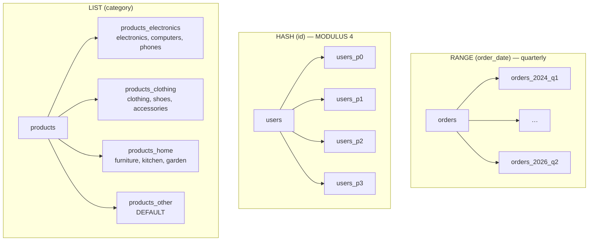

# Simulate Database Partitioning Using Docker

A demonstration of PostgreSQL table partitioning strategies using Docker and Go.

## Tech Stack

- **Programming Language**: Go 1.26.0
- **Container**: Docker Compose
- **Database**: PostgreSQL 18

## Partitioning Strategies Demonstrated

1. **Range Partitioning** - Orders table partitioned by date (quarterly)
2. **Hash Partitioning** - Users table partitioned by user ID (4 partitions)
3. **List Partitioning** - Products table partitioned by category

### Architecture



## Quick Start

```bash
# Start PostgreSQL
docker compose up -d

# Wait for database to be ready
docker logs -f partitioned_postgres

# Install Go dependencies
go mod tidy

# Run the demo
go run main.go
```

## Cleanup

```bash
docker compose down -v

# delete everything
docker compose down --volumes --rmi all --remove-orphans
```

## Project Structure

```
.
├── docker-compose.yml      # PostgreSQL container setup
├── init/
│   └── 01_create_partitioned_table.sql  # Partition schema
├── main.go                 # Go demo application
├── go.mod                  # Go module definition
└── README.md
```
