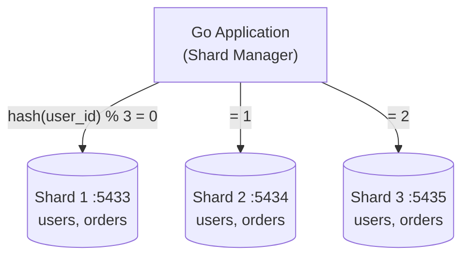

# Simulate Database Sharding Using Docker

## Tech Stack

- **Programming Language**: Go 1.26.0
- **Container**: Docker Compose
- **Database**: PostgreSQL 18 (3 separate instances as shards)

## Overview

This project demonstrates **horizontal database sharding** - distributing data across multiple independent database instances. Unlike partitioning (which splits data within a single database), sharding distributes data across completely separate database servers.

### Key Concepts Demonstrated

1. **Hash-based Sharding**: Users are distributed across shards using FNV-1a hashing (modulo shard count) on user ID
2. **Data Co-location**: Orders are stored on the same shard as their associated user
3. **Shard Manager**: Application-level routing to direct queries to the correct shard
4. **Scatter-Gather Queries**: Querying all shards in parallel when the shard key is unknown
5. **Cross-Shard Aggregation**: Aggregating data from multiple shards

### Architecture



## How to Run

### 1. Start the database shards

```bash
docker compose up -d
```

Wait for all three PostgreSQL instances to be healthy:

```bash
docker compose ps
```

### 2. Download Go dependencies

```bash
go mod tidy
```

### 3. Run the application

```bash
go run main.go
```

## Expected Output

The application will demonstrate:

1. **User Sharding**: Inserting users and showing which shard each user is routed to
2. **Order Sharding**: Inserting orders co-located with their users
3. **Scatter-Gather**: Searching for a user by username across all shards
4. **Shard Statistics**: Showing data distribution across shards
5. **Cross-Shard Aggregation**: Aggregating order statistics from all shards in parallel

## Sharding vs Partitioning

| Aspect                  | Partitioning   | Sharding                |
| ----------------------- | -------------- | ----------------------- |
| Database instances      | Single         | Multiple                |
| Data location           | Same server    | Different servers       |
| Scalability             | Vertical       | Horizontal              |
| Complexity              | Lower          | Higher                  |
| Cross-partition queries | Easy (same DB) | Requires scatter-gather |
| Transaction support     | Full ACID      | Limited (distributed)   |

## Cleanup

```bash
docker compose down -v
```
