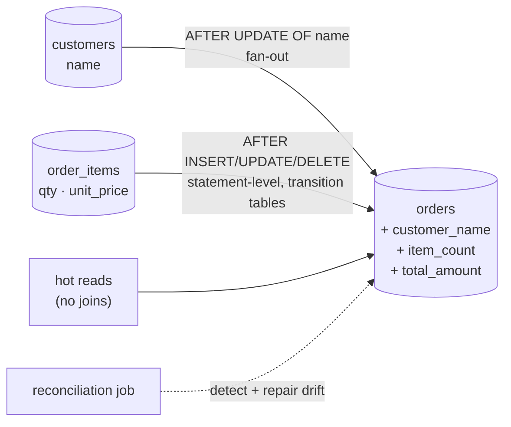

# Simulate Database Denormalization Using Docker

## Tech Stack

- **Programming Language**: Go 1.26.0
- **Container**: Docker Compose
- **Database**: PostgreSQL 18 (single instance, 200k orders / ~600k order items)

## Overview

Normalization stores each fact once; reads reassemble data with joins and aggregates.
**Denormalization** deliberately stores **redundant, derived copies** next to where
they're read, so hot queries skip that work. The bill comes due on writes: every copy
must be updated, and any code path that forgets creates **drift**.

This project adds three redundant columns to `orders` — `customer_name`, `item_count`,
`total_amount` — keeps them in sync with **triggers**, and measures both sides of the
trade.

### Key Concepts Demonstrated

1. **Strategic redundancy** — copies of a parent's attribute (`customer_name`) and of
   child aggregates (`item_count`, `total_amount`).
2. **Read speedup** — order list ~250x faster; revenue dashboard ~6x faster.
3. **Trigger-maintained consistency** — insert/update/delete of items adjusts totals;
   statement-level triggers with **transition tables** handle bulk changes in one pass.
4. **Write fan-out** — renaming a customer rewrites all 10,000 of their orders.
5. **Drift and reconciliation** — a bypassing write path corrupts totals; a
   reconciliation query detects and repairs them.
6. **Application-level alternative** — update the copy in the same transaction.

### Architecture



## How to Run

```bash
docker compose up -d --wait     # first boot seeds ~800k rows (~20 s)
go mod tidy
go run main.go
```

## Expected Output (abridged)

```
⚡ READS — 'latest 50 orders of a customer' with name, item count, total
   normalized   (joins + GROUP BY):    26.59 ms
   denormalized (single table):         0.10 ms   → 259x faster
⚡ READS — 'top 10 customers by revenue, last 30 days'
   normalized   (joins + GROUP BY):    26.00 ms
   denormalized (single table):         4.50 ms   → 6x faster
🔁 CONSISTENCY — triggers maintain the copies automatically
   new order (3 items):               customer_name="Customer 42" item_count=3 total=263.98
   after qty += 10 on one line:       customer_name="Customer 42" item_count=3 total=1205.58
✍️  WRITE COST — renaming one customer
   rename customer 2 (≈100 orders)        7.94 ms
   rename customer 1 (10,000 orders)    126.43 ms
🧟 DRIFT — a code path that bypasses the sync logic
   reconciliation query finds 100 orders whose totals are wrong ❌
🧹 RECONCILE — recompute copies from the source of truth
   repaired 100 orders in 278ms; drift now: 0 ✅
```

## Ways to Keep Copies Consistent

| Approach                    | Consistency            | Pros                                   | Cons                                         |
| --------------------------- | ---------------------- | -------------------------------------- | -------------------------------------------- |
| **Triggers** (this demo)    | Same transaction       | Every writer covered, incl. ad-hoc SQL | Hidden write cost; harder to debug           |
| **Application code**        | Same transaction       | Explicit, testable                     | Every write path must remember               |
| **Async (outbox / CDC)**    | Eventual               | Writes stay fast; cross-service        | Readers can see stale copies                 |
| **Materialized view**       | At refresh             | Declarative                            | Stale between refreshes (see [`simulate_materialized_views`](../simulate_materialized_views)) |
| **Generated column**        | Always (same row only) | Zero maintenance                       | Can't reference other rows/tables            |

Whatever you choose, run a **reconciliation query** periodically.

## When to Use

- Read-heavy paths that join/aggregate the same data on every request (order lists,
  feeds, counters, leaderboards).
- Copied attributes that change rarely (names, categories) and aggregates over small
  child sets.

Avoid denormalizing attributes that change often or fan out to huge numbers of rows.

## Notes on "not outdated"

- Statement-level triggers with `REFERENCING NEW TABLE / OLD TABLE` (transition
  tables) instead of row-by-row triggers for aggregates.
- Identity columns; `IS DISTINCT FROM` for NULL-safe comparisons.
- `NUMERIC` values carried as text in Go to avoid float rounding.

## Cleanup

```bash
docker compose down -v
```
