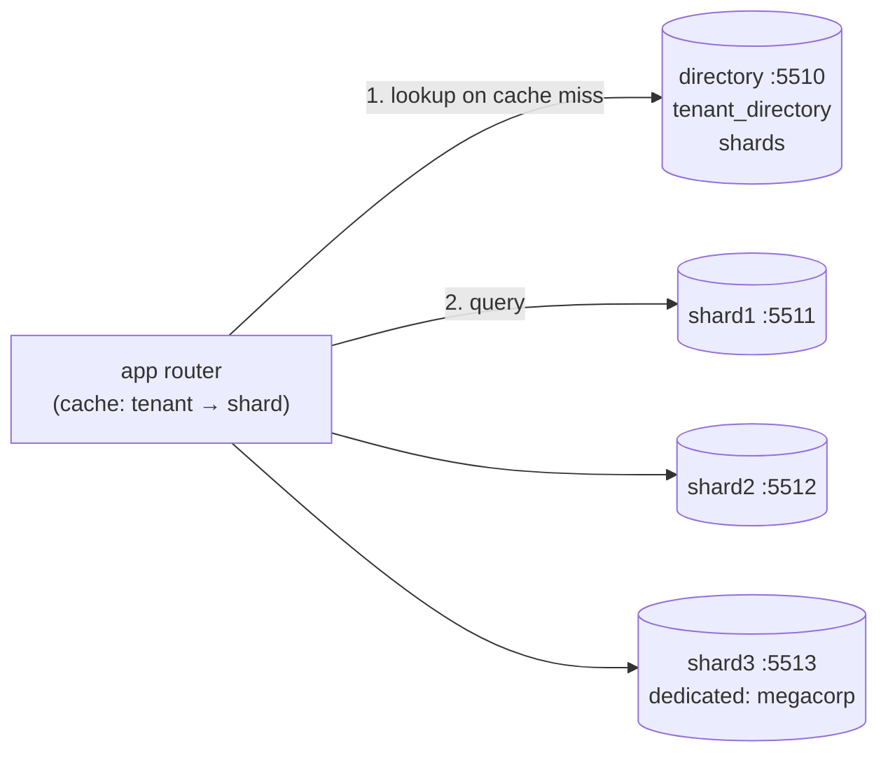

# Simulate Directory-Based Sharding Using Docker

## Tech Stack

- **Programming Language**: Go 1.26.0
- **Container**: Docker Compose
- **Database**: PostgreSQL 18 (1 directory database + 3 shard databases)

## Overview

Hash-based sharding computes a key's location (`hash(key) % N`). **Directory-based
sharding** *looks it up*: a small directory database maps each key — here, each
tenant — to the shard that holds it. Because placement is data rather than a formula,
you can put any tenant anywhere, move one at a time, and add shards without rehashing
anybody.

### Key Concepts Demonstrated

1. **Lookup service** — `tenant_directory (tenant_id → shard)` plus a `shards` registry
   holding each shard's DSN (new shards are discovered, not deployed).
2. **Dynamic assignment** — new tenants go to the open shard with the fewest rows.
3. **Routing cache** — 300 routed reads need only 6 directory lookups.
4. **Adding capacity** — registering `shard3` moves nothing.
5. **Moving a hotspot** — `megacorp` (6,000 orders) is migrated to a dedicated shard by
   copying its rows and flipping its directory row.
6. **Stale-cache fencing** — a second app instance with an outdated mapping is rejected
   by the old shard (`hosted_tenants`) and re-routes itself.
7. **Comparison with hash routing** — going from 2 to 3 shards with `hash % N` relocates
   half the tenants.

### Architecture



### Moving a tenant

```mermaid
sequenceDiagram
    participant R as router
    participant D as directory
    participant Src as source shard
    participant Dst as target shard
    R->>D: status = 'moving'
    R->>Src: BEGIN; DELETE hosted_tenants row (fence up)
    R->>Src: SELECT tenant's rows
    R->>Dst: COPY rows + INSERT hosted_tenants; COMMIT
    R->>Src: DELETE tenant's rows; COMMIT
    R->>D: shard = target, version + 1, status = 'active'
```

## How to Run

```bash
docker compose up -d --wait
go mod tidy
go run main.go
```

The program resets every database at startup, so it can be re-run.

## Expected Output (abridged)

```
   shard1   6300 rows █████████████████████████
   shard2    700 rows ██
   ⚠️  megacorp alone makes its shard a HOTSPOT
   300 routed reads: 6 directory lookups, 294 cache hits
🚚 MOVE A HOTSPOT — migrate megacorp to dedicated shard3
   moved 6000 rows in 90ms; only megacorp's rows moved, nobody else's
🧟 STALE CACHE — app-2 still thinks megacorp lives on its old shard
   write fenced out by hosted_tenants on the old shard → refreshed → wrote to shard3 (retried=true)
🆚 VS HASH ROUTING — what adding a shard would have cost
   hash routing: 3/6 tenants must move. directory: 0 (we moved 1, by choice)
```

## Directory vs Hash vs Range Routing

| Aspect                   | Directory                        | Hash (`% N` / consistent)      | Range                         |
| ------------------------ | -------------------------------- | ------------------------------ | ----------------------------- |
| Locate a key             | Lookup (cached)                  | Compute                        | Compute / small table         |
| Add a shard              | Moves nothing                    | Many keys (`% N`) / ~1/N (ring) | Split a range                 |
| Move one hot key         | Yes — copy + flip a row          | No                             | Only by splitting its range   |
| Placement policy         | Anything (load, region, tier)    | Fixed by hash                  | Fixed by key order            |
| Extra infrastructure     | Directory (must be HA + cached)  | None                           | Range map                     |

See [`simulate_database_sharding`](../simulate_database_sharding),
[`simulate_consistent_hashing`](../simulate_consistent_hashing) and
[`simulate_range_based_sharding`](../simulate_range_based_sharding).

## When to Use

- Multi-tenant SaaS with very uneven tenant sizes, where big tenants need their own
  shard and small ones can be packed together.
- When you need data residency / placement rules ("EU tenants on EU shards").
- When you expect to rebalance often and want to move units one at a time.

## Notes on "not outdated"

- Tenant moves use the COPY protocol (`pgx.CopyFrom`) rather than row-by-row inserts.
- pgx v5 generics: `pgx.CollectRows`, `pgx.RowTo[T]`; Go 1.26 `maps.Keys` + `slices.Collect`.
- Fencing with `FOR SHARE` on a per-shard ownership row instead of trusting caches.

## Cleanup

```bash
docker compose down -v
```
