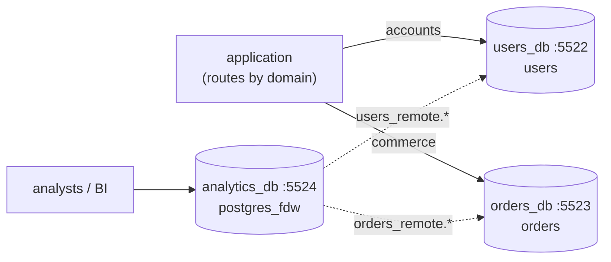

# Simulate Federation / Functional Partitioning Using Docker

## Tech Stack

- **Programming Language**: Go 1.26.0
- **Container**: Docker Compose
- **Database**: PostgreSQL 18 — `users_db`, `orders_db`, `analytics_db` (with `postgres_fdw`)

## Overview

**Federation** (functional partitioning) splits one database into several **by
business domain** — users, orders, analytics — each on its own server. Sharding splits
*one table's rows* across servers; federation splits *different tables* across servers.

Each domain database can be sized, tuned, scaled, backed up and owned by its team
independently, and a spike in one domain no longer starves the others. What you lose is
everything that needs a *single* database: cross-domain `JOIN`s, foreign keys, and
transactions.

### Key Concepts Demonstrated

1. **Domain routing** — the application sends each request to its domain's database.
2. **Application-side join** — aggregate in `orders_db`, then batch-fetch users from
   `users_db` with `WHERE id = ANY($1)` (2 round trips, no N+1).
3. **Federated SQL with `postgres_fdw`** — `analytics_db` imports both schemas as
   foreign tables; `EXPLAIN VERBOSE` shows `GROUP BY … LIMIT` pushed down to the remote.
4. **Expensive federated joins** — a cross-server join that can't be pushed down ships
   whole tables to the analytics server.
5. **Lost integrity** — an order for a non-existent user is accepted; an orphan check
   finds it.

### Architecture



## How to Run

```bash
docker compose up -d --wait
go mod tidy
go run main.go
```

## Expected Output (abridged)

```
🧩 CROSS-DOMAIN QUERY, IN THE APP — 'top 5 customers by spend'
   user 2004  User 2004  VN  spend   2542.02
   2 round trips (orders_db aggregate → users_db lookup by id) in 13.335ms
🔗 CROSS-DOMAIN QUERY, WITH postgres_fdw — same question, one SQL
     ↳ Remote SQL: SELECT id, name, country FROM public.users
     ↳ Remote SQL: SELECT user_id, sum(amount)::double precision FROM public.orders
       GROUP BY 1 ORDER BY sum(amount)::double precision DESC NULLS FIRST LIMIT 5::bigint
🌍 WHEN FEDERATED JOINS GET EXPENSIVE — 'revenue by country'
     ↳ Remote SQL: SELECT user_id, amount FROM public.orders ORDER BY user_id ASC NULLS LAST
     ↳ Remote SQL: SELECT id, country FROM public.users
💔 LOST GUARANTEE — no foreign keys across databases
   INSERT order for user 999999 → accepted (err=<nil>)
   orphan check via fdw: 1 order(s) reference a missing user ❌
```

## Cross-Database Query Options

| Option                       | How                                     | Good for                          | Watch out for                        |
| ---------------------------- | --------------------------------------- | --------------------------------- | ------------------------------------ |
| **App-side join**            | Query A, then batch-fetch from B        | Small, targeted lookups           | N+1 queries; app complexity          |
| **`postgres_fdw`**           | Foreign tables, one SQL statement       | Ad-hoc / analyst queries          | Non-pushable joins ship whole tables |
| **Replicate into analytics** | Logical replication / CDC / ETL         | Heavy reporting                   | Staleness, pipeline to operate       |
| **Denormalize copies**       | Store needed fields in the other domain | Hot read paths                    | Keeping copies in sync (events)      |

## Trade-offs

| Benefit                                         | Cost                                                 |
| ----------------------------------------------- | ---------------------------------------------------- |
| Independent scaling, tuning, failure domains    | No cross-domain JOINs, FKs, or ACID transactions     |
| Smaller databases: faster backup/restore/vacuum | Integrity enforced by the app (validation, sagas)    |
| Clear ownership per team/service                | More servers and connection pools to operate         |
| Natural step toward microservices               | Reporting needs fdw or a data pipeline               |

## When to Use

- Distinct domains with different load profiles (e.g. write-heavy orders vs read-heavy
  catalogue) outgrowing one server.
- Teams/services that should own their data independently.

Do it *before* sharding when tables are naturally separable — it's simpler. Avoid it
when most queries join across the would-be domains.

## Notes on "not outdated"

- `postgres_fdw` with `IMPORT FOREIGN SCHEMA` and `use_remote_estimate`; aggregate,
  sort and limit pushdown (PG12+).
- Batched app joins with `= ANY($1)` and pgx v5 `CollectRows`.

## Cleanup

```bash
docker compose down -v
```
