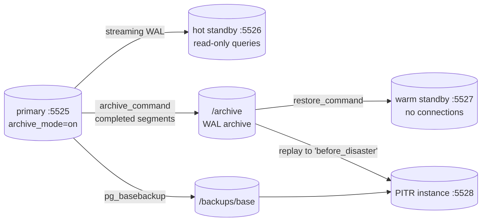
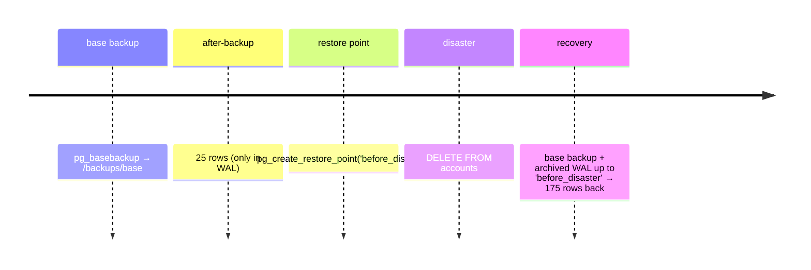

# Simulate Hot Standby (vs Warm Standby) + Point-in-Time Recovery Using Docker

## Tech Stack

- **Programming Language**: Go 1.26.0
- **Container**: Docker Compose
- **Database**: PostgreSQL 18 (primary with WAL archiving, hot standby, warm standby, PITR instance)

## Overview

A **standby** is a copy of the primary kept current by replaying its write-ahead log
(WAL). Two classic flavours:

| | **Warm standby** | **Hot standby** |
|---|---|---|
| WAL delivery | Archived 16 MB segment files (**log shipping**, `restore_command`) | **Streaming** replication |
| Client queries while in recovery | ❌ refused (`hot_standby = off`) | ✅ read-only |
| Lag / data at risk on failover | Up to one un-archived segment (bounded by `archive_timeout`) | Typically milliseconds |
| Purpose | Failover target only | Failover target **and** read scaling |

Both replicate **everything** — including mistakes. A `DELETE` without `WHERE` reaches
every standby within moments. Protection against that comes from **point-in-time
recovery (PITR)**: a base backup plus the WAL archive can rebuild the database as it was
at any moment, such as just before the mistake.

### Key Concepts Demonstrated

1. **Hot vs warm** — the hot standby answers queries; the warm one rejects connections.
2. **Streaming** — commits appear on the hot standby within milliseconds.
3. **Log shipping RPO** — promoting the warm standby loses rows that were still in the
   current, un-archived WAL segment.
4. **WAL archiving** — `archive_mode` + `archive_command`, observed via `pg_stat_archiver`.
5. **Base backup** — `pg_basebackup` to a backup volume.
6. **Replicas are not backups** — a bad `DELETE` is replicated instantly.
7. **PITR** — restore the base backup, replay archived WAL to a named restore point,
   promote: all rows are back, including those written after the backup.

### Architecture



### PITR timeline



## How to Run

```bash
docker compose up -d --wait
go mod tidy
go run main.go
```

The demo promotes the warm standby and starts the PITR instance (compose profile
`pitr`). Both are recreated with fresh volumes (`docker compose up -V`) at the start of
each run, so it can be re-run.

## Expected Output (abridged)

```
🔌 CONNECT TO EACH STANDBY
   hot  standby: ✅ accepts read-only queries (pg_is_in_recovery = true)
   warm standby: ❌ FATAL: the database system is not accepting connections (SQLSTATE 57P03)
📡 STREAMING — the hot standby sees commits almost immediately
   100 rows committed on primary → visible on hot standby after 252ms
🚨 PRIMARY LOST — promote the warm standby
   hot  standby has 150 rows
   warm standby (now primary) has 100 rows ← batch-2 lost: RPO = un-archived WAL
💥 DISASTER — someone runs DELETE without a WHERE clause
   primary: 0 rows   hot standby: 0 rows
   ❌ the hot standby replicated the DELETE — replicas are NOT backups
⏪ POINT-IN-TIME RECOVERY — base backup + archived WAL up to the restore point
   recovered instance up in 10.274s with 175 rows ✅
```

## Recovery Options Compared

| Option             | Protects against            | RPO                        | RTO                        |
| ------------------ | --------------------------- | -------------------------- | -------------------------- |
| Hot standby        | Primary hardware/node loss  | ~0 (async: seconds)        | Seconds (promote)          |
| Warm standby       | Primary loss                | Un-archived WAL            | Seconds–minutes            |
| Delayed standby    | Recent mistakes (window)    | `recovery_min_apply_delay` | Minutes                    |
| PITR               | Mistakes, corruption, loss  | Last archived WAL          | Restore + replay time      |

## When to Use

- **Hot standby** — almost always: HA failover target plus read capacity.
- **Warm standby** — DR site reached only via archive storage (no direct network path),
  or where minimal standby resources are acceptable.
- **PITR** — always, alongside any standby. Production tools (pgBackRest, Barman, WAL-G)
  add compression, parallelism, retention and object-storage archives.

## Notes on "not outdated"

- `standby.signal` / `recovery.signal` + settings in `postgresql.auto.conf` (PG12+);
  no `recovery.conf`.
- `pg_create_restore_point` + `recovery_target_name` + `recovery_target_action = promote`.
- `archive_command` with `test ! -f` guard; `pg_stat_archiver` monitoring.

## Cleanup

```bash
docker compose --profile pitr down -v
```
