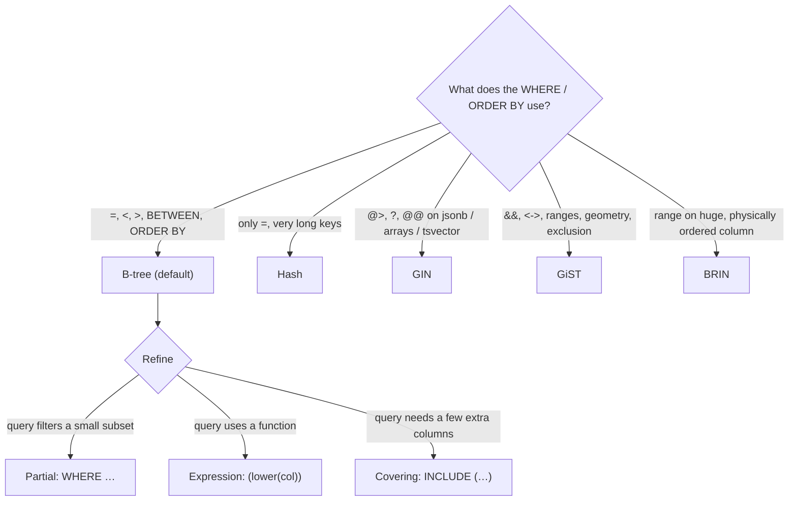

# Simulate Database Indexing Strategies Using Docker

## Tech Stack

- **Programming Language**: Go 1.26.0
- **Container**: Docker Compose
- **Database**: PostgreSQL 18 (single instance; extensions `pgstattuple`, `btree_gist`)

## Overview

Before adding replicas or shards, make each query read less. Indexes are the cheapest
scaling lever, but there is no single "index": each type serves particular operators
and data shapes, and every index costs disk, cache, write throughput and maintenance.

This project starts from a 1M-row `orders` table and a 100k-row `reservations` table
with **no secondary indexes**, then adds each index type and shows the query plan,
pages read and latency before and after.

### Key Concepts Demonstrated

| Index           | Query shape                                   | Result in the demo                          |
| --------------- | --------------------------------------------- | ------------------------------------------- |
| **B-tree**      | `customer_id = 4242`                          | Seq Scan 23k pages → Index Scan 13 pages    |
| **Hash**        | `email = '…'` (equality only)                 | Fast `=`, useless for range/ORDER BY; larger than B-tree here |
| **Expression**  | `lower(email) = '…'`                          | Plain index ignored; `lower(email)` index used |
| **Partial**     | `status = 'pending' ORDER BY created_at`      | Same speed as a full index at **1/100 the size** |
| **Covering**    | `SELECT customer_id, sum(amount)`             | `INCLUDE (amount)` → Index Only Scan, Heap Fetches 0 |
| **GIN**         | `attrs @> '{…}'`, `tags @> ARRAY[…]`          | ~20x faster containment queries              |
| **GiST**        | `during && tstzrange(…)`                      | Overlap search + **exclusion constraint** blocks double-booking |
| **BRIN**        | `created_at` range on ordered data            | 24 kB vs 21 MB B-tree, ~60x faster than a seq scan |

Plus: **write overhead** (inserts with 10 indexes vs 1), **bloat** after updates and
`REINDEX CONCURRENTLY`, and **unused-index detection** with `pg_stat_user_indexes`.

### Choosing an index



## How to Run

```bash
docker compose up -d --wait     # first boot seeds 1.1M rows (~30 s)
go mod tidy
go run main.go
```

Every run drops the demo indexes and `CLUSTER`s the table first, so results are
repeatable.

## Expected Output (abridged)

```
🌳 B-TREE — equality on customer_id
   before Seq Scan                                     26.307 ms   23621 pages
   + idx_orders_customer           9256 kB  built in 249ms
   after  Index Scan using idx_orders_customer          0.021 ms      13 pages
🎯 PARTIAL — 'oldest 20 pending orders' (pending = 1% of rows)
   + idx_orders_status_created       30 MB  built in 652ms
   + idx_orders_pending             240 kB  built in 63ms
🧾 COVERING — INCLUDE columns for an index-only scan
   after  Index Only Scan using idx_orders_customer_cover   0.169 ms   8 pages, Heap Fetches: 0
📐 GiST — overlapping time ranges + exclusion constraint
   double-book room 7 → ❌ conflicting key value violates exclusion constraint "no_double_booking" (23P01)
🧱 BRIN vs B-TREE
   + idx_orders_created_btree        21 MB
   + idx_orders_created_brin         24 kB
✍️  WRITE OVERHEAD — every index must be updated on INSERT
   20,000 inserts with only the PK:            54 ms
   20,000 inserts with 10 indexes:            410 ms  (7.5x slower)
🫧 BLOAT — updates leave dead index entries; REINDEX CONCURRENTLY
   fresh:                          9256 kB   leaf density  91.8%
   after 2×333k updates + VACUUM:    18 MB   leaf density  70.5%
   after REINDEX CONCURRENTLY:     9256 kB   leaf density  89.8%
🕵️  UNUSED INDEXES — pg_stat_user_indexes.idx_scan
   idx_orders_amount            scans=0         43 MB ← never used: drop candidate
```

## Trade-offs

| Benefit                                  | Cost                                                  |
| ---------------------------------------- | ----------------------------------------------------- |
| Orders-of-magnitude fewer pages read     | Disk and buffer-cache space                           |
| Enables index-only scans, sorted output  | Slower INSERT/UPDATE/DELETE (every index maintained)  |
| Constraints (unique, exclusion)          | Bloat → periodic `REINDEX CONCURRENTLY`               |
| Cheaper than more hardware               | Planner may still choose not to use it — verify with `EXPLAIN` |

## When to Use

- Always index foreign keys and columns in frequent `WHERE`/`JOIN`/`ORDER BY` clauses.
- Prefer **partial** and **covering** indexes for hot, selective queries.
- Audit `pg_stat_user_indexes` regularly and drop indexes with `idx_scan = 0` (excluding
  unique/PK, and checking replicas — stats are per server).

## Notes on "not outdated"

- `INCLUDE` covering indexes (PG11+), crash-safe hash indexes (PG10+),
  `REINDEX … CONCURRENTLY` (PG12+), `jsonb_path_ops` GIN opclass.
- `EXPLAIN (ANALYZE, BUFFERS, FORMAT JSON)` parsed in Go; Go 1.26 `errors.AsType`.

## Cleanup

```bash
docker compose down -v
```
