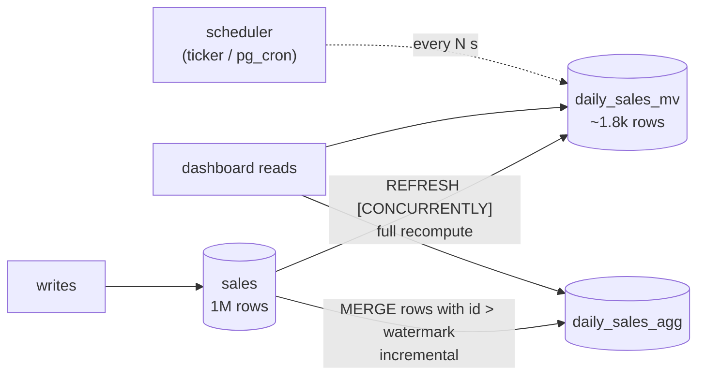

# Simulate Materialized Views Using Docker

## Tech Stack

- **Programming Language**: Go 1.26.0
- **Container**: Docker Compose
- **Database**: PostgreSQL 18 (single instance, 1M-row `sales` table)

## Overview

A **materialized view** stores the *result* of a query on disk. Reading it is a cheap
lookup instead of re-running an expensive aggregate over millions of rows. The price
is **staleness**: the stored result only changes when it is **refreshed**.

This project precomputes "revenue per region per day" from a 1,000,000-row fact table
and compares the refresh strategies you can choose from.

### Key Concepts Demonstrated

1. **Read speedup** — raw `GROUP BY` over 1M rows vs a lookup in the MV (~200x).
2. **Staleness** — new rows are invisible until `REFRESH MATERIALIZED VIEW`.
3. **On-demand refresh** — plain `REFRESH` locks out readers (`ACCESS EXCLUSIVE`).
4. **`REFRESH … CONCURRENTLY`** — readers keep going; requires a unique index.
5. **Periodic refresh** — a scheduler refreshes every N seconds → staleness ≤ ~N.
6. **Incremental refresh** — a summary table updated with only new rows via `MERGE`
   and a watermark: milliseconds instead of a full recompute.

### Architecture



## How to Run

```bash
docker compose up -d --wait     # first boot seeds 1M rows (~10–20 s)
go mod tidy
go run main.go
```

## Expected Output (abridged)

```
⚡ READ COST — raw aggregate vs materialized view
   raw GROUP BY over sales (1M rows):      44.78 ms
   same answer from daily_sales_mv:         0.19 ms
🕰️  STALENESS — new sales are invisible until REFRESH
   today's revenue in MV: 150847.49 (unchanged — stale)
   REFRESH MATERIALIZED VIEW took 235 ms
🔒 REFRESH vs REFRESH CONCURRENTLY — do readers block?
   REFRESH                in progress → reader: ❌ BLOCKED (lock timeout after 500ms)
   REFRESH CONCURRENTLY   in progress → reader: ✅ served immediately
➕ INCREMENTAL REFRESH — only process new rows (MERGE + watermark)
   incremental refresh of 1,000 new rows:      3 ms
   full REFRESH CONCURRENTLY for comparison:    248 ms
   ✅ daily_sales_agg (incremental) == daily_sales_mv (full refresh)
```

## Refresh Strategies

| Strategy                  | Readers blocked? | Cost per refresh           | Staleness        | Notes                                  |
| ------------------------- | ---------------- | -------------------------- | ---------------- | -------------------------------------- |
| `REFRESH` (on demand)     | **Yes**          | Full recompute + rewrite   | Until next call  | Fastest full refresh; brief outage     |
| `REFRESH CONCURRENTLY`    | No               | Full recompute + diff      | Until next call  | Needs a unique index; more I/O         |
| Periodic (cron/pg_cron)   | No (w/ CONCURRENTLY) | Full recompute every N | ≤ N + refresh time | Simple, predictable                 |
| Incremental summary table | No               | Proportional to new rows   | As often as you like | You write the merge logic          |

## When to Use

- Dashboards, reports, leaderboards: expensive aggregates read far more often than the
  data changes, where seconds-to-minutes of staleness is fine.
- Use the **incremental** approach once a full refresh becomes too slow to run as often
  as you need.

Avoid when reads must reflect the latest write (use a regular view or index tuning) or
when the base data changes so fast that refresh never catches up.

## Notes on "not outdated"

- `REFRESH MATERIALIZED VIEW CONCURRENTLY` (not drop-and-recreate).
- `MERGE` (PG15+) for the incremental upsert; identity columns instead of `SERIAL`.
- Go 1.26: `errors.AsType`, `sync.WaitGroup.Go`, built-in `min`.

## Cleanup

```bash
docker compose down -v
```
