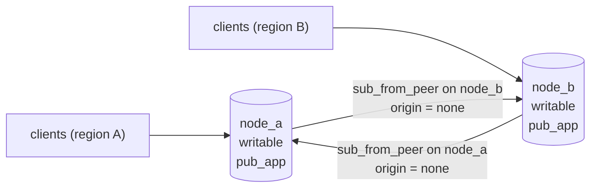
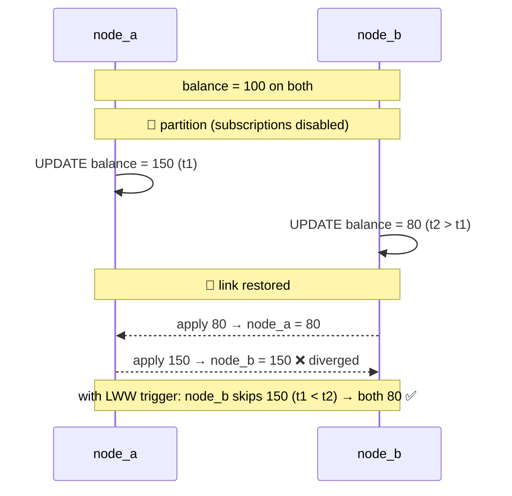

# Simulate Multi-Primary Replication Using Docker

## Tech Stack

- **Programming Language**: Go 1.26.0
- **Container**: Docker Compose
- **Database**: PostgreSQL 18 (two writable nodes, bidirectional logical replication)

## Overview

In **multi-primary** (active-active) replication every node accepts writes and ships
them to every other node. It is used for **geographic distribution** (users write to
the nearest region) and **high availability** (no promotion step — another primary is
already writable).

The catch is **conflicts**: two nodes can change the same row at the same time, and
with asynchronous replication neither knows until later. This project builds a
two-node cluster with native PostgreSQL logical replication and shows conflicts
happening, being detected, and being resolved.

### Key Concepts Demonstrated

1. **Bidirectional logical replication** — each node publishes and subscribes to the
   other; `origin = none` (PG16+) stops changes from bouncing back forever.
2. **Conflict avoidance** — per-node identity sequences (`1,11,21…` vs `2,12,22…`), so
   concurrent INSERTs never collide.
3. **Silent divergence** — concurrent UPDATEs during a partition leave the nodes with
   *different* values and no error.
4. **Conflict detection** — PostgreSQL 18 logs `conflict=update_origin_differs` and
   counts it in `pg_stat_subscription_stats` (requires `track_commit_timestamp`).
5. **Last-writer-wins resolution** — a trigger enabled with `ENABLE REPLICA TRIGGER`
   rejects older remote updates, so both nodes converge.

### Architecture



### The conflict, step by step



## How to Run

```bash
docker compose up -d --wait
go mod tidy
go run main.go
```

The program drops and recreates the subscriptions on every run, so it is repeatable.

## Expected Output

```
💥 CONFLICT — same row updated on both nodes during a partition
   node_a: balance = 150   (t1)
   node_b: balance =  80   (t2, slightly later)
   after reconnect → node_a: 80.00   node_b: 150.00
   ❌ DIVERGED. Each node applied the OTHER node's update last.
   node_a pg_stat_subscription_stats: update_origin_differs=1 insert_exists=0

🛡️  RESOLUTION — last-writer-wins (LWW) with a replica trigger
   after reconnect → node_a: 80.00   node_b: 80.00
   ✅ CONVERGED on the newer write (node_b's).
```

## Conflict Resolution Strategies

| Strategy                    | How                                              | Loses data?               |
| --------------------------- | ------------------------------------------------ | ------------------------- |
| **Avoidance (key design)**  | Per-node sequences, UUIDv7, or home-node per key | No — conflicts can't occur |
| **Last-writer-wins**        | Compare timestamps (+ node tie-break)            | Yes — the older write     |
| **Commutative / CRDT**      | Counters and sets merged, not overwritten        | No, but limited op types  |
| **Application merge**       | Record both versions, resolve in code / by user  | No, but complex           |
| **Built-in (PG)**           | Always "apply remote"                            | Yes — and nodes diverge   |

## Multi-Primary Trade-offs

| Benefit                               | Cost                                              |
| ------------------------------------- | ------------------------------------------------- |
| Low-latency local writes in each region | Conflicts — must be avoided or resolved          |
| No failover step for writes            | Only eventual consistency between nodes          |
| Survives loss of a node or region     | DDL isn't replicated; schemas must be kept in sync |
| Write capacity spread across nodes     | Every node still applies every write (no write scaling per se) |

## When to Use

- Multi-region apps where users mostly write "their own" data (data naturally
  partitioned by region/user, so conflicts are rare).
- When writes must continue in a region cut off from the others.

Avoid it when you need strict cross-node consistency (bank balances, inventory) —
use a single primary, synchronous replication, or a consensus-based database (see
[`simulate_newsql`](../simulate_newsql)).

## Notes on "not outdated"

- Native logical replication with `origin = none` (PG16+) — no BDR/pglogical needed
  for the basic topology, and no trigger-based replication (Bucardo).
- PostgreSQL 18 conflict logging and `pg_stat_subscription_stats.confl_*` counters.
- `ENABLE REPLICA TRIGGER` for apply-only logic; Go 1.25+ `sync.WaitGroup.Go`.

## Cleanup

```bash
docker compose down -v
```
