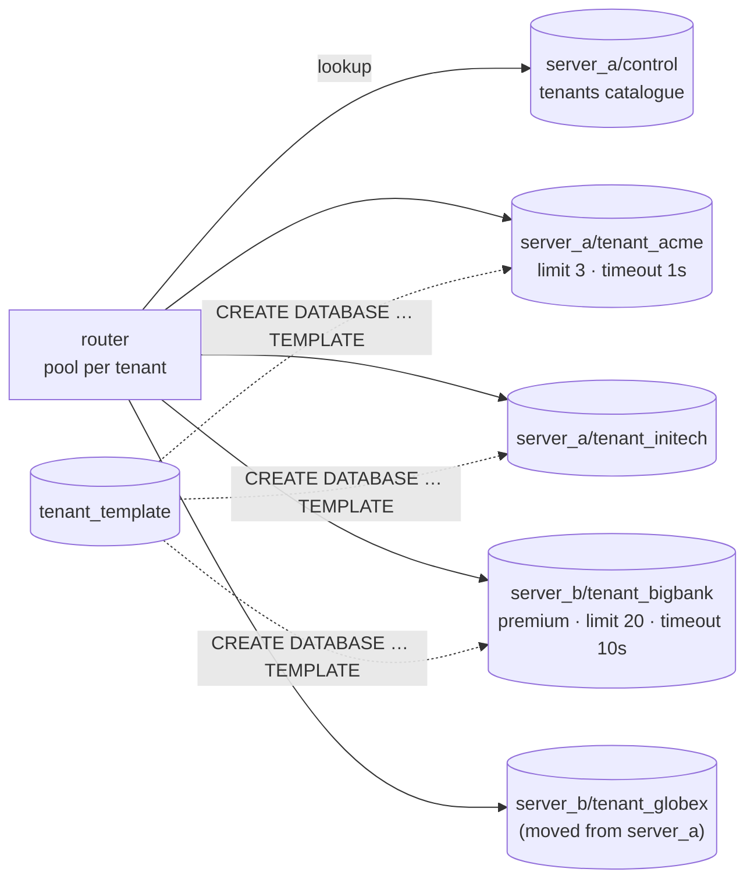

# Simulate Multi-Tenancy (Separate Database per Tenant) Using Docker

## Tech Stack

- **Programming Language**: Go 1.26.0
- **Container**: Docker Compose
- **Database**: PostgreSQL 18 — `server_a` (shared, `max_connections=60`, control plane) and `server_b` (dedicated)

## Overview

In the **separate database** model every tenant gets its own PostgreSQL **database**,
cloned from a template, with its own login role — and it can live on any server. Tenants
share nothing at the SQL level: no tables, no catalog, no credentials. Resource
controls (connection limits, timeouts) apply per database, and a tenant can be backed
up, restored, moved or dropped as a single unit.

The price is operational: one connection pool per tenant, migrations across N databases,
and many more objects to monitor.

### Key Concepts Demonstrated

1. **Provisioning from a template** — `CREATE ROLE`, `CREATE DATABASE … OWNER …
   TEMPLATE tenant_template`, `REVOKE CONNECT … FROM PUBLIC`.
2. **Tenant catalogue routing** — `control.tenants` maps tenant → server + database;
   the router keeps a pool per tenant.
3. **Full isolation** — cross-database references are impossible, and one tenant's
   credentials can't connect to another tenant's database.
4. **Per-tenant resource management** — `CONNECTION LIMIT` stops a noisy tenant without
   affecting others; `ALTER DATABASE … SET statement_timeout` differs by plan.
5. **Per-tenant accounting** — size, connections and commits per database.
6. **Migrations × N databases** with per-database version tracking.
7. **Moving a tenant** to another server with `pg_dump -Fc | pg_restore -C`.
8. **Offboarding** with `DROP DATABASE … WITH (FORCE)`.
9. **Connection explosion** — warm pools per tenant exhaust a 60-connection server.

### Architecture



## How to Run

```bash
docker compose up -d --wait
go mod tidy
go run main.go
```

Every tenant database and role from earlier runs is dropped at startup (this can take
some seconds: dropping databases forces checkpoints).

## Expected Output (abridged)

```
🛡️  FULL ISOLATION — a tenant connection can't even name another database
   acme: SELECT … FROM tenant_globex.public.invoices → ❌ cross-database references are not implemented
   acme's credentials → connect to tenant_globex → ❌ permission denied for database "tenant_globex"
🚦 PER-TENANT RESOURCE LIMITS — CONNECTION LIMIT and statement_timeout
   acme (limit 3, its pool already holds 2) opens 6 more → 1 accepted, 5 refused:
   ❌ too many connections for database "tenant_acme"
   globex   (standard) 2s report query → ❌ canceling statement due to statement timeout after 1s
   bigbank  (premium) 2s report query → ✅ completed after 2s
🚚 MOVE A TENANT — globex outgrew the shared server → server_b
   pg_dump | pg_restore + catalogue update in 2.373s; globex on server_b has 50 invoices
💥 CONNECTION EXPLOSION — a pool per tenant on a 60-connection server
   opened warm pools for 27 more tenants (2 connections each), then:
   ❌ tenant small27: remaining connection slots are reserved for roles with the SUPERUSER attribute
```

## Resource Management Challenges

| Challenge             | Why it happens                                | Mitigation                                         |
| --------------------- | --------------------------------------------- | -------------------------------------------------- |
| Connection explosion  | Pools × tenants × app instances               | PgBouncer, lazy pools that close when idle         |
| Noisy neighbours      | Tenants on one server share CPU/RAM/IO        | `CONNECTION LIMIT`, per-DB timeouts, move to own server |
| Migrations            | N databases to change, some may fail          | Versioned, idempotent, resumable rollout           |
| Memory per database   | Each backend caches its DB's catalog          | Fewer tenants per server                           |
| Monitoring & backups  | N databases to watch and back up              | Automation driven by the tenant catalogue          |
| Cross-tenant analytics| No cross-database queries                     | ETL / CDC into a warehouse                         |

## When to Use

- Enterprise/regulated tenants that demand hard isolation, separate credentials,
  per-tenant backup/restore, or placement on dedicated hardware.
- Tens to a few hundred tenants per server, typically large ones.

For many small tenants use [shared schema](../simulate_multitenancy_shared_schema) or
[separate schema](../simulate_multitenancy_separate_schema); hybrids (small tenants
shared, big tenants dedicated) are common.

## Notes on "not outdated"

- `DROP DATABASE … WITH (FORCE)` (PG13+); `CREATE DATABASE` uses the WAL_LOG strategy
  by default (PG15+).
- `REVOKE CONNECT … FROM PUBLIC` and per-tenant login roles (superusers bypass
  `CONNECTION LIMIT`).
- pg_dump custom format piped straight into pg_restore; Go 1.26 `maps.Keys`, `errors.AsType`.

## Cleanup

```bash
docker compose down -v
```
