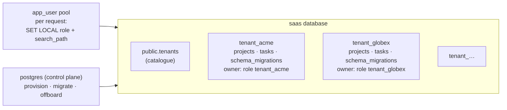

# Simulate Multi-Tenancy (Separate Schema) Using Docker

## Tech Stack

- **Programming Language**: Go 1.26.0
- **Container**: Docker Compose
- **Database**: PostgreSQL 18 (one database, one schema per tenant)

## Overview

In **shared database, separate schema** multi-tenancy every tenant gets its own
**schema** — a namespace containing its own copy of every table (`tenant_acme.projects`,
`tenant_globex.projects`, …). All tenants share one database server and connection
pool, but their data never sits in the same table.

Requests are routed by setting `search_path` to the tenant's schema, so application SQL
stays unqualified (`SELECT … FROM projects`). This project adds a second layer: each
tenant has its own **role**, and every request switches to it, so even an explicitly
qualified query against another tenant's schema is denied.

### Key Concepts Demonstrated

1. **Transactional provisioning** — role + schema + tables + catalogue entry in one
   transaction (PostgreSQL DDL is transactional).
2. **Connection routing** — `set_config('search_path', schema, true)` and
   `set_config('role', schema, true)` per transaction (`SET LOCAL` semantics).
3. **Privilege isolation** — `GRANT tenant_x TO app_user WITH INHERIT FALSE, SET TRUE`
   (PG16+): the app can switch to a tenant role but holds no tenant privileges itself.
4. **Pool pitfall** — a session-level `SET search_path` leaks to the next request on
   the same pooled connection; the role layer stops the cross-tenant read.
5. **Per-schema migrations** — versioned with a `schema_migrations` table per tenant.
6. **Per-tenant customization, backup (`pg_dump -n`), and offboarding (`DROP SCHEMA`)**.
7. **Scaling limits** — 300 tenants add ~3,600 relations and ~21,000 catalog columns;
   migrations grow linearly.

### Architecture



## How to Run

```bash
docker compose up -d --wait
go mod tidy
go run main.go
```

All tenant schemas and roles from previous runs are dropped at startup.

## Expected Output (abridged)

```
🧭 ROUTING — same unqualified SQL, different schema per tenant
   tenant acme     SELECT count(*) FROM projects → 5   (search_path=tenant_acme)
   tenant globex   SELECT count(*) FROM projects → 3   (search_path=tenant_globex)
🛡️  ISOLATION — acme tries to read globex's schema explicitly
   SELECT … FROM tenant_globex.projects as acme → ❌ permission denied for schema tenant_globex
🧟 POOL PITFALL — session-level SET leaks to the next request
   request 2 (globex): forgot to set tenant; connection still has search_path=tenant_acme
   → SELECT FROM projects: ❌ relation "projects" does not exist
🔧 MIGRATION — roll a schema change out to every tenant schema
   v2 applied to 3 schemas in 10ms (each tenant tracks its own version)
💾 PER-TENANT BACKUP & OFFBOARDING
   pg_dump -n tenant_acme → 4505 bytes: one tenant's data, nobody else's
📈 SCALE — catalog growth with many tenants
   pg_class:        444 →   4044 relations
   one migration across 302 schemas: 931ms — grows linearly with tenants
```

## The Three Multi-Tenancy Models

| Aspect               | Shared schema (RLS)           | **Separate schema**                 | Separate database               |
| -------------------- | ----------------------------- | ----------------------------------- | ------------------------------- |
| Isolation            | Row policies                  | Namespace + roles                   | Full (database / server)        |
| Tenants per server   | Millions                      | Hundreds to low thousands           | Tens to hundreds                |
| Migrations           | Once                          | × N schemas                         | × N databases                   |
| Per-tenant backup    | Hard (filter rows)            | `pg_dump -n`                        | `pg_dump` per DB                |
| Customization        | No                            | Possible per schema                 | Easy                            |
| Connection pooling   | One pool                      | One pool (transaction-scoped SET)   | Pool per tenant                 |

See [`simulate_multitenancy_shared_schema`](../simulate_multitenancy_shared_schema) and
[`simulate_multitenancy_separate_database`](../simulate_multitenancy_separate_database).

## When to Use

- B2B SaaS with hundreds to a few thousand tenants that want stronger isolation than
  row-level policies, per-tenant export/restore, or occasional customizations.
- Regulatory or contractual requirements for logical separation without separate
  servers.

Avoid it for very large tenant counts (catalog bloat, slow migrations and dumps).

## Notes on "not outdated"

- `GRANT … WITH INHERIT FALSE, SET TRUE` (PG16+) for switch-only role membership.
- Transaction-scoped `set_config(…, true)` — safe with pgxpool/PgBouncer transaction mode.
- `REVOKE CREATE ON SCHEMA public` (the PG15+ default) made explicit.

## Cleanup

```bash
docker compose down -v
```
