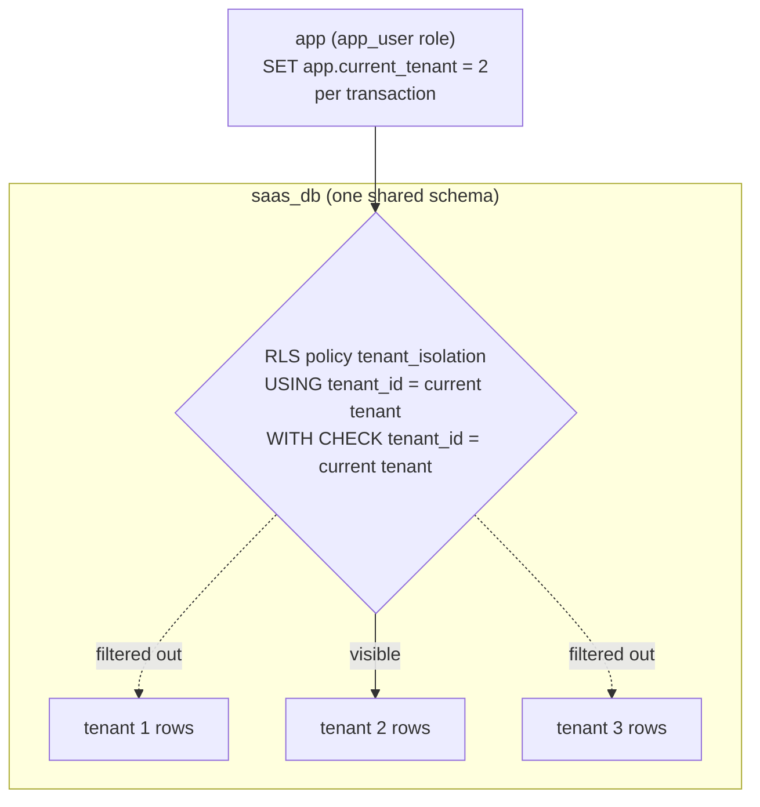

# Simulate Multi-Tenancy (Shared Schema) Using Docker

## Tech Stack

- **Programming Language**: Go 1.26.0
- **Container**: Docker Compose
- **Database**: PostgreSQL 18 (single shared database)

## Overview

In **shared database, shared schema** multi-tenancy, every tenant's data lives in
the **same tables**, distinguished by a `tenant_id` column. It's the cheapest,
densest model — one schema, one connection pool, thousands of tenants — but it
lives or dies by **isolation**: one missing `WHERE tenant_id = ...` and a tenant
sees another's data.

This project enforces isolation in the database with **PostgreSQL Row-Level
Security (RLS)** instead of trusting every query. A policy ties each row to the
session's `app.current_tenant` setting, so even a query with no tenant filter only
ever returns the current tenant's rows.

### Key Concepts Demonstrated

1. **Tenant discriminator** — a `tenant_id` column on shared tables.
2. **Row-Level Security** — `USING` (reads) and `WITH CHECK` (writes) policies.
3. **Session context** — `set_config('app.current_tenant', ...)` per transaction.
4. **Non-superuser role** — the app connects as `app_user` so RLS actually applies.
5. **Fail-closed** — no tenant set ⇒ the query errors, it does not leak everything.

### Architecture



## How to Run

```bash
docker compose up -d
docker compose ps         # wait until healthy
go mod tidy
go run main.go
```

## Expected Output

Each tenant sees only its own documents. A cross-tenant read returns **0 rows**
(RLS hides it), a forged cross-tenant insert is **rejected** by `WITH CHECK`, and a
query run with **no tenant set errors out** instead of leaking all rows.

## Multi-Tenancy Models Compared

| Model                          | Isolation     | Density | Ops cost | This project |
| ------------------------------ | ------------- | ------- | -------- | ------------ |
| **Shared DB, shared schema**   | Logical (RLS) | Highest | Lowest   | ✅ here      |
| **Shared DB, separate schema** | Medium        | Medium  | Medium   | —            |
| **Separate DB per tenant**     | Strongest     | Lowest  | Highest  | —            |

Shared schema gives the best density and lowest cost; RLS buys back much of the
isolation you'd otherwise get from physical separation.

## Cleanup

```bash
docker compose down -v
```
