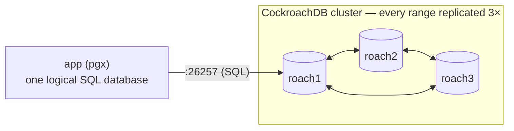

# Simulate NewSQL (CockroachDB) Using Docker

## Tech Stack

- **Programming Language**: Go 1.26.0
- **Container**: Docker Compose
- **Database**: CockroachDB v26.2 (3-node cluster, PostgreSQL wire-compatible)

## Overview

**NewSQL** databases give you the familiar SQL interface and **ACID** guarantees of a
traditional RDBMS, while scaling **horizontally** and tolerating node failures like a
distributed system. This project runs a **3-node CockroachDB cluster** and shows what
you get "for free" compared to hand-rolled sharding.

The key contrast is with [`simulate_database_sharding`](../simulate_database_sharding):

|                          | Manual sharding                                                              | NewSQL (CockroachDB)               |
| ------------------------ | ---------------------------------------------------------------------------- | ---------------------------------- |
| Shard routing            | Application picks the shard                                                  | Automatic (data split into ranges) |
| Cross-shard transactions | Effectively impossible                                                       | Ordinary `BEGIN … COMMIT`          |
| Replication / HA         | You build it                                                                 | Built-in Raft, 3× replication      |
| Failover                 | Manual (see [`simulate_automatic_failover`](../simulate_automatic_failover)) | Automatic, no failover step        |
| Rebalancing              | Manual data movement                                                         | Automatic                          |

Because CockroachDB speaks the PostgreSQL wire protocol, the **same `pgx` driver**
used throughout this repo connects to it unchanged.

### Key Concepts Demonstrated

1. **Automatic sharding + replication** — `accounts` is split into ranges, each
   replicated to 3 nodes via Raft, with **no application-level shard key**.
2. **Distributed ACID transaction** — a money transfer commits atomically even when
   the rows live on different nodes.
3. **Serializable isolation** — CockroachDB defaults to `SERIALIZABLE`; concurrent
   transfers are retried on conflict (`SQLSTATE 40001`) with no lost updates.
4. **Fault tolerance** — stop a node and queries keep succeeding, no manual failover.

### Architecture



## How to Run

```bash
docker compose up -d      # 3 nodes + a one-shot `init` that bootstraps the cluster
docker compose ps         # wait until roach1 is healthy (nodes refuse SQL pre-init)
go mod tidy
go run main.go
```

DB Console UI: <http://localhost:8090>

## Expected Output

The table is created with plain SQL and is automatically split into ranges replicated
across nodes `[1 2 3]`. A transfer runs as a single serializable distributed
transaction; eight concurrent transfers commit with no lost updates. The program then
explains how to test fault tolerance live.

### Verify fault tolerance yourself

```bash
docker compose stop roach2   # kill one of the three nodes
go run main.go               # queries STILL succeed — Raft has a quorum (2 of 3)
docker compose start roach2  # bring it back; it re-syncs automatically
```

## Notes on "not outdated"

- Uses CockroachDB **v26.2** (latest stable series).
- Avoids `crdb_internal`/`system` tables, which v26 restricts by default (enabling
  them via `allow_unsafe_internals` is explicitly _not recommended_). Topology is read
  from the supported `SHOW RANGES … WITH DETAILS` surface instead.
- Serialization conflicts are handled with a proper **retry loop** on `SQLSTATE
40001` — the canonical way to use a serializable database.

## Cleanup

```bash
docker compose down -v
```
