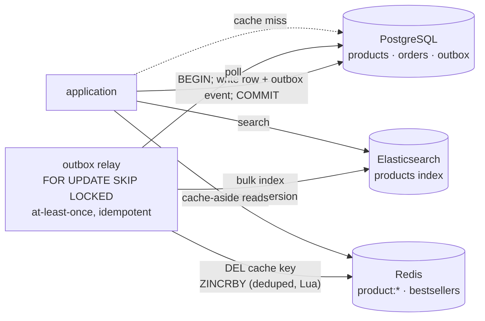

# Simulate Polyglot Persistence Using Docker

## Tech Stack

- **Programming Language**: Go 1.26.0
- **Container**: Docker Compose
- **Databases**: PostgreSQL 18 (system of record), Redis 8 (cache + leaderboard), Elasticsearch 9.1 (search)

## Overview

**Polyglot persistence** means using several database technologies in one system, each
for the access pattern it handles best, instead of forcing one engine to do everything:

| Store             | Job here                                   | Why it fits                                        |
| ----------------- | ------------------------------------------ | -------------------------------------------------- |
| **PostgreSQL**    | Products, orders — the source of truth     | ACID transactions, constraints, SQL                |
| **Redis**         | Product cache, best-seller leaderboard     | In-memory, sub-millisecond, sorted sets            |
| **Elasticsearch** | Product search                             | Typo-tolerant full-text, relevance ranking, facets |

The hard part is **data synchronization**. This project uses the **transactional
outbox** pattern: the application writes only to PostgreSQL — the business row *and* an
outbox event in one transaction — and a **relay** applies the events to Redis and
Elasticsearch **idempotently**. Derived stores may lag briefly, but never permanently
diverge, and can always be rebuilt from PostgreSQL.

### Key Concepts Demonstrated

1. **Single write path** — PostgreSQL + outbox in one transaction; no dual writes.
2. **Search** — `wireles headphnes` (two typos): 0 hits in PostgreSQL (`ILIKE` and
   full-text), 188 relevance-ranked hits with facets in Elasticsearch.
3. **Cache-aside** — product page served from Redis after the first read (~10x faster).
4. **Leaderboard** — order events update a Redis sorted set incrementally.
5. **Eventual consistency** — right after a commit, Elasticsearch is stale; ~200 ms later
   it has caught up and the cache entry was invalidated.
6. **Relay outage** — writes keep succeeding; the outbox backlog drains on restart.
7. **Rebuild** — drop the search index and reindex it from PostgreSQL.

### Architecture



## How to Run

```bash
docker compose up -d --wait     # Elasticsearch takes ~30 s to become healthy
go mod tidy
go run main.go
```

Every run truncates PostgreSQL, flushes Redis and recreates the search index.
Elasticsearch needs ~1 GB of RAM (heap is set to 512 MB).

## Expected Output (abridged)

```
📥 WRITE ONCE — products go to PostgreSQL + outbox, the relay fans out
   3000 products: PostgreSQL ✓, relay → Elasticsearch ✓ in 1.201s
🔍 SEARCH — 'wireles headphnes' (two typos)
   PostgreSQL ILIKE: 0 hits   PostgreSQL full-text: 0 hits (no typo tolerance)
   Elasticsearch (fuzzy, relevance-ranked): 188 hits in 33ms, top 3:
     Pulse Wireless Headphones 100                audio        $ 252.79
⚡ PRODUCT PAGE — Redis cache-aside in front of PostgreSQL
   read 1: Echo USB-C from PostgreSQL in 919µs
   read 2: Echo USB-C from Redis      in 99µs
⏳ EVENTUAL CONSISTENCY — update a product, read every store immediately
   right after COMMIT → PostgreSQL: "Aurora Wireless Headphones PRO"
                        Elasticsearch: "Echo USB-C Hub 141" ← stale (relay hasn't run yet)
   after relay (232ms) → Elasticsearch: "Aurora Wireless Headphones PRO", Redis cache invalidated
🛑 RELAY OUTAGE — writes keep working, events queue up
   relay down: 50 updates committed to PostgreSQL, outbox backlog = 50
   relay back: backlog drained in 125ms
```

## Data Synchronization Strategies

| Strategy                         | Consistency                    | Risk                                             |
| -------------------------------- | ------------------------------ | ------------------------------------------------ |
| **Dual write** from the app      | None guaranteed                | One write succeeds, the other fails → divergence |
| **Transactional outbox** (this)  | Eventual, no lost events       | Relay to operate; events applied at least once   |
| **CDC** (Debezium, logical decoding) | Eventual, no app changes   | Extra infrastructure (Kafka/connectors)          |
| **Periodic batch reindex**       | Stale between runs             | Simple; fine for rarely-changing data            |

Whatever the transport, appliers must be **idempotent**: here via Elasticsearch
external versions (older versions are rejected) and Redis dedupe keys (each order
event increments the leaderboard once).

## Trade-offs

| Benefit                                         | Cost                                                  |
| ----------------------------------------------- | ----------------------------------------------------- |
| Each workload on the engine built for it        | More systems to run, secure, back up, monitor          |
| Search/cache load taken off the primary DB      | Eventual consistency between stores                    |
| Independent scaling per store                   | Sync pipeline is critical infrastructure               |
| Derived stores are disposable (rebuildable)     | Team must know several technologies                    |

## When to Use

- A clear access pattern PostgreSQL handles poorly at your scale: typo-tolerant search
  and facets, very hot key-value reads, real-time counters/leaderboards, graph
  traversal, time series at huge volume.
- Not before you need it: PostgreSQL's own full-text search, `pg_trgm`, JSONB and
  materialized views cover many cases with one system.

## Notes on "not outdated"

- Transactional outbox + `FOR UPDATE SKIP LOCKED` relay instead of dual writes.
- Elasticsearch 9 REST `_bulk` with `version_type=external`; Redis 8 with an atomic Lua
  dedupe script via go-redis v9.
- Go 1.26: `slices.Chunk`, `sync.WaitGroup.Go`, `math/rand/v2`, pgx `RowToStructByPos`.

## Cleanup

```bash
docker compose down -v
```
