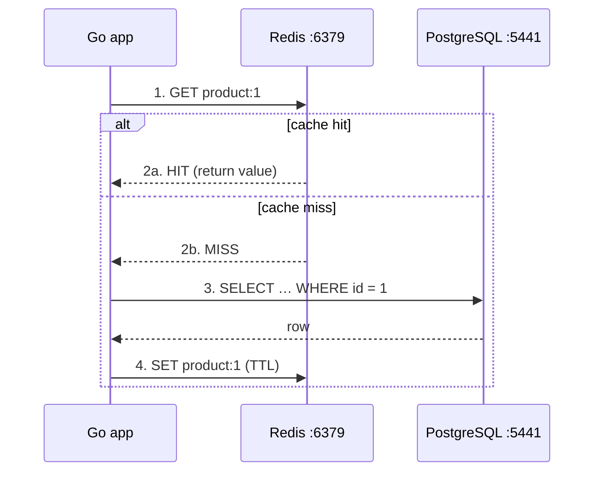

# Simulate Query Caching Using Docker

## Tech Stack

- **Programming Language**: Go 1.26.0
- **Container**: Docker Compose
- **Database**: PostgreSQL 18
- **Cache**: Redis 7

## Overview

Reads usually dominate database load, and many of them are repetitive. A **cache**
(Redis) stores query results in memory so repeated reads skip the database
entirely. This project demonstrates the **cache-aside** pattern plus the common
write/invalidation strategies that keep a cache from serving stale data.

To make the speed-up visible, the database read is deliberately slowed by ~50 ms
(a stand-in for an expensive join/aggregation). Cache hits return in
microseconds.

### Key Concepts Demonstrated

1. **Cache-aside (lazy loading)** — read cache → on miss read DB → populate cache.
2. **TTL** — entries expire automatically to bound staleness.
3. **Write-through** — update DB and cache together so reads stay fresh.
4. **Write + invalidate** — update DB and delete the cache entry.
5. **Graceful degradation** — if Redis is down, fall back to the database.
6. **Hit ratio** — the metric that tells you whether caching is working.

### Architecture



## Caching Strategies

| Strategy               | On write...                       | Staleness window         | Used here in              |
| ---------------------- | --------------------------------- | ------------------------ | ------------------------- |
| **Cache-aside**        | (nothing special)                 | up to the TTL            | `GetProduct`              |
| **Write-through**      | write DB **and** cache            | tiny window between DB commit and cache SET (single-threaded demo eliminates it) | `UpdatePriceWriteThrough` |
| **Write + invalidate** | write DB, delete cache key        | none (next read reloads) | `UpdatePriceInvalidate`   |
| **TTL expiry**         | entry self-destructs after N secs | bounded by TTL           | `demonstrateTTL`          |

## How to Run

```bash
docker compose up -d      # start PostgreSQL + Redis
go mod tidy
go run main.go
```

## Expected Output

A cold read pays the DB penalty; the warm read is served from Redis orders of
magnitude faster. Write-through keeps the next read fresh and fast; invalidation
forces a reload; TTL expiry removes a key automatically. A hit-ratio summary is
printed at the end.

## Cleanup

```bash
docker compose down -v
```
