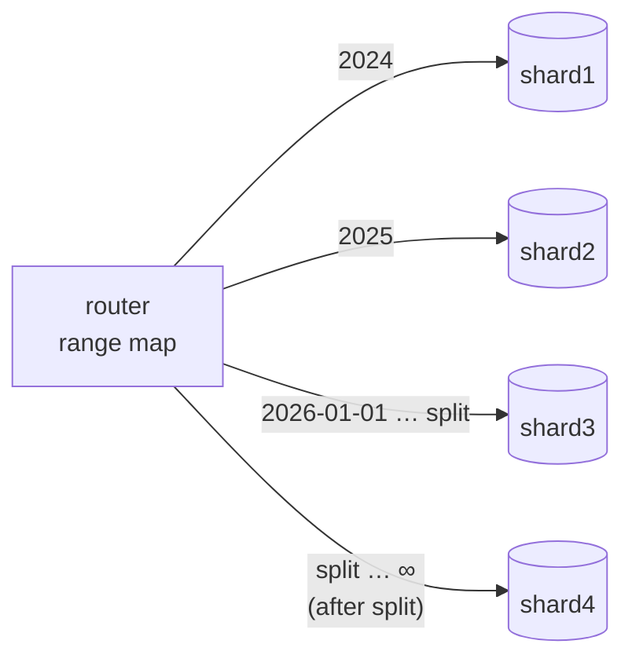
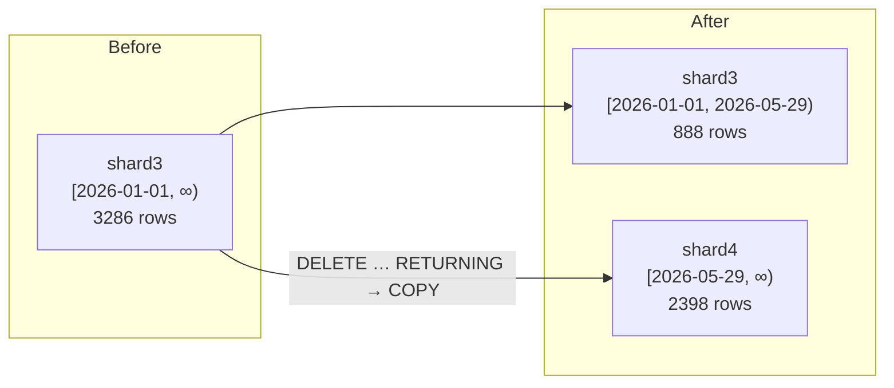

# Simulate Range-Based Sharding Using Docker

## Tech Stack

- **Programming Language**: Go 1.26.0
- **Container**: Docker Compose
- **Database**: PostgreSQL 18 (4 shard instances)

## Overview

In **range-based sharding** each shard owns a contiguous **range of the shard key** —
here, the order date. Rows with neighbouring keys live together, so a range query
("orders in March last year") visits one shard instead of all of them. The same
property is its weakness: load follows the key distribution. With a time-based key,
**every new write lands in the newest range**, creating a hotspot, and ranges grow at
different speeds, so they need **splitting and rebalancing** over time.

Other common range keys are alphabetical (`A–F`, `G–M`, …), numeric ids, and
geography (a region → shard list is the categorical cousin of a range map).

### Key Concepts Demonstrated

1. **Range map** — `[From, To) → shard`, held by the application.
2. **Range-query pruning** — a one-month query visits only the shard owning that month.
3. **Write hotspot** — 100% of new orders hit the newest range's shard.
4. **Rebalancing by splitting** — cut the large range in two; only rows in the upper
   half move to a new shard.
5. **Splitting doesn't fix append hotspots** — the newest range just moves.
6. **Mitigation** — spread the *current* range over several shards by `customer_id`
   (a hash-prefixed range), at the cost of multi-shard recent-data queries.

### Architecture



### Rebalancing by splitting a range



## How to Run

```bash
docker compose up -d --wait
go mod tidy
go run main.go
```

Ranges are computed relative to the current year, and every shard is truncated at
startup, so the demo is always current and repeatable.

## Expected Output (abridged)

```
🔍 RANGE QUERY — 'revenue in March last year' touches ONE shard
   shards visited: [shard2] (of 4) → revenue 18411.47
🔥 WRITE HOTSPOT — new orders all have created_at = now()
   shard3  1500 writes (100%) █████████████████████████
✂️  SPLIT — shard3's range grew; split it at 2026-05-29 → shard4
   moved 2398 rows from shard3 to shard4 (shard1/shard2 untouched)
🔥 HOTSPOT AGAIN — splitting a time range doesn't fix APPEND load
   shard4  1500 writes (100%) █████████████████████████
🧩 MITIGATION — spread the CURRENT range across shards by customer
   shard3   767 writes ( 51%) ████████████
   shard4   733 writes ( 48%) ████████████
```

## Range vs Hash Sharding

| Aspect                 | Range                                   | Hash                                |
| ---------------------- | --------------------------------------- | ----------------------------------- |
| Range queries          | ✅ One or few shards                     | ❌ Scatter-gather to all shards       |
| Write distribution     | ❌ Hotspots for sequential keys          | ✅ Even                              |
| Data locality          | ✅ Related keys together                 | ❌ Neighbours scattered              |
| Rebalancing            | Split / merge one range                 | Rehash (`% N`) or ring moves (~1/N) |
| Archiving old data     | ✅ Drop/detach an old shard's range      | ❌ Old data on every shard           |

## Handling Hotspots and Rebalancing

- **Split** ranges that grow too big (size-based) or too hot (load-based); move one half.
- **Merge** small neighbouring ranges to reduce shard count.
- **Avoid monotonic keys** for write-heavy data, or prefix them with a hash/bucket (as in
  the mitigation step) — the approach used by HBase salting and Bigtable key design.
- Systems such as CockroachDB, TiDB and YugabyteDB split and move ranges automatically
  (see [`simulate_newsql`](../simulate_newsql)).

## When to Use

- Workloads dominated by range scans on the shard key (time-series reads, reporting by
  period, alphabetical listings).
- Data with a natural lifecycle where whole old ranges can be archived.

Avoid plain time ranges for write-heavy append workloads unless current data is bucketed.

## Notes on "not outdated"

- `uuidv7()` (PostgreSQL 18) for globally unique, time-ordered ids across shards.
- Row moves with `DELETE … RETURNING` + COPY protocol (`pgx.CopyFrom`).
- Go 1.26: `math/rand/v2`, `slices.Replace`, `slices.IndexFunc`.

## Cleanup

```bash
docker compose down -v
```
