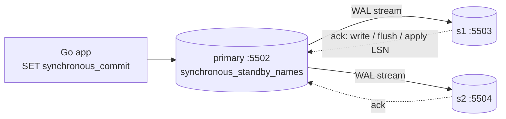
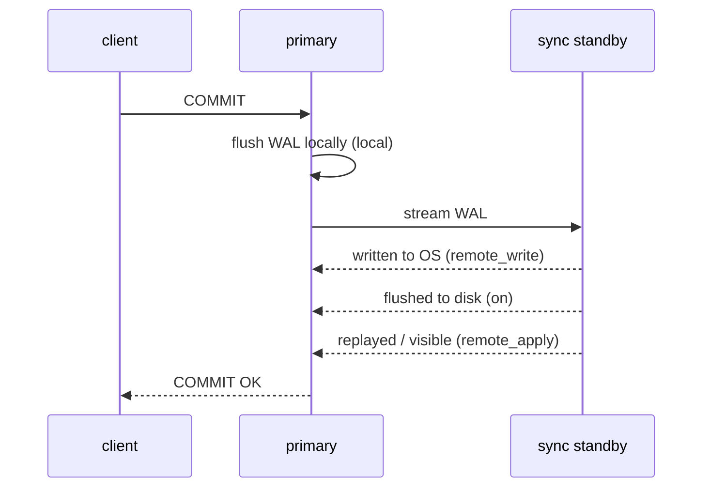

# Simulate Synchronous vs Asynchronous Replication Using Docker

## Tech Stack

- **Programming Language**: Go 1.26.0
- **Container**: Docker Compose
- **Database**: PostgreSQL 18 (primary + two named streaming standbys `s1`, `s2`)

## Overview

Every replicated database must decide **when a COMMIT is "done"**: as soon as the
primary has it (asynchronous), or only after one or more standbys confirm it
(synchronous). That single decision trades **write latency and availability**
against **durability and read consistency**.

PostgreSQL exposes it as two settings, both changeable at runtime:

| Setting                     | Answers                     | Values                                                          |
| --------------------------- | --------------------------- | --------------------------------------------------------------- |
| `synchronous_standby_names` | *Which* standbys to wait for | `''` (async), `FIRST n (s1, s2)` (priority), `ANY n (s1, s2)` (quorum) |
| `synchronous_commit`        | *How far* to wait            | `local`, `remote_write`, `on` (remote flush), `remote_apply`    |

### Key Concepts Demonstrated

1. **Async commit** — fast, but standbys can serve **stale reads**.
2. **Sync commit levels** — latency of `local` → `remote_write` → `on` → `remote_apply`.
3. **Read-your-writes** — `remote_apply` makes a committed row immediately visible on
   the sync standby.
4. **The availability cost** — when the sync standby stalls, **every commit blocks**;
   cancelling only abandons the wait (the row is already committed locally).
5. **Quorum commit** — `ANY 1 (s1, s2)` keeps committing while one standby is slow,
   and blocks only when the quorum can't be met.

### Architecture



### What a synchronous COMMIT waits for



## How to Run

```bash
docker compose up -d --wait
go mod tidy
go run main.go
```

The program resets `synchronous_standby_names` and resumes WAL replay on exit, so it
can be re-run safely.

## Expected Output (abridged)

```
1️⃣  ASYNC — commit returns after the LOCAL flush
   standby s1  streaming  sync_state=async     priority=0
2️⃣  ASYNC → STALE READS on a standby
   s1 sees id=201? false  ← stale read: commit didn't wait for s1
3️⃣  SYNC (FIRST 1 (s1, s2))
   standby s1  streaming  sync_state=sync      priority=1
   standby s2  streaming  sync_state=potential priority=2
   sync, synchronous_commit=remote_apply   avg commit 15.340 ms
5️⃣  THE PRICE — sync standby stalls ⇒ commits BLOCK
   INSERT … COMMIT hung 2s waiting for the sync standby until cancelled
   ⚠️  server: canceling wait for synchronous replication due to user request
       The transaction has already committed locally, but might not have been replicated
6️⃣  QUORUM — ANY 1 (s1, s2)
   s1 paused, yet commit id=2007 returned in 10ms (s2 acknowledged)
```

> All containers share one host, so the latency gap is small (local fsync dominates).
> Across availability zones each sync level adds a network round trip (~1–2 ms);
> across regions, tens of milliseconds per commit.

## Trade-offs

| Mode                    | Data loss on primary crash      | Commit latency     | Stalled standby ⇒        | Stale standby reads |
| ----------------------- | ------------------------------- | ------------------ | ------------------------ | ------------------- |
| **Async**               | Possible (last few commits)     | Lowest             | Nothing (lag grows)      | Yes                 |
| **Sync `on`**           | None for acknowledged commits   | +1 RTT + fsync     | **All writes block**     | Yes (until replay)  |
| **Sync `remote_apply`** | None                            | Highest            | All writes block         | No (on sync standby) |
| **Quorum `ANY k`**      | None (k copies)                 | +RTT of k-th fastest | Blocks only if < k healthy | Depends on level  |

## When to Use

- **Async** — read replicas, analytics, DR copies where losing a few seconds of writes
  on failover is acceptable.
- **Sync / quorum** — financial or order data where an acknowledged commit must survive
  losing the primary. Use **quorum** with ≥2 standbys so one slow node doesn't stop
  writes; this is also what Patroni's `synchronous_mode` builds on.

## Notes on "not outdated"

- `FIRST n` / `ANY n` syntax (PG10+), not the legacy comma-list form.
- Runtime changes via `ALTER SYSTEM` + `pg_reload_conf()` — no restart.
- Standby identity via `cluster_name` (used as the WAL receiver's `application_name`).
- PostgreSQL 18 images; pgx v5 with `pgx.BeginFunc` and `SET LOCAL` per transaction.

## Cleanup

```bash
docker compose down -v
```
