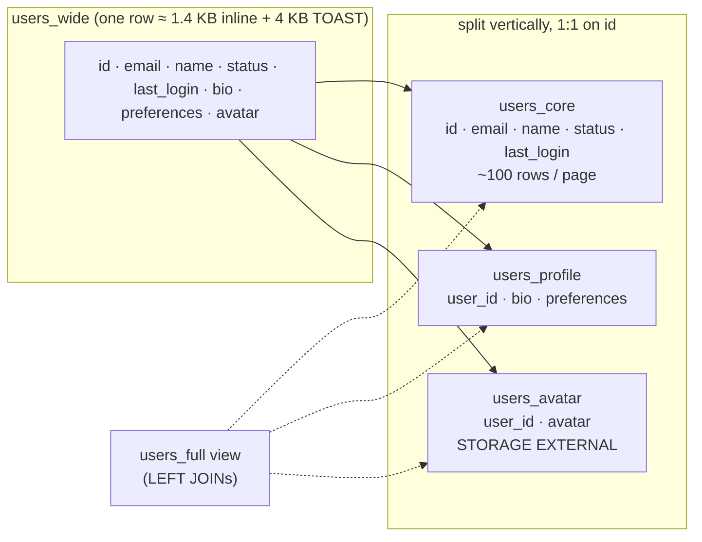

# Simulate Vertical Partitioning Using Docker

## Tech Stack

- **Programming Language**: Go 1.26.0
- **Container**: Docker Compose
- **Database**: PostgreSQL 18 (single instance)

## Overview

**Horizontal** partitioning splits a table by rows. **Vertical partitioning** splits it
by **columns**: the columns read on every request stay in a narrow "hot" table, while
rarely-read text and large binary objects (BLOBs) move to 1:1 side tables sharing the
same primary key.

A row is the unit PostgreSQL reads, caches, and rewrites on update. When a table mixes
`status` and `last_login` with a 1 KB `bio`, every scan of the small columns reads the
big ones too, and every update of `last_login` rewrites the whole row. This project
stores the same 30,000 users both ways and measures the difference.

### Key Concepts Demonstrated

1. **Splitting by access pattern** — `users_core` (hot), `users_profile` (cold text),
   `users_avatar` (BLOB).
2. **Inline vs TOAST** — values under ~2 KB stay inline and bloat every row; larger
   values are TOASTed but still fetched by `SELECT *`.
3. **Pages read** by hot queries (`EXPLAIN (ANALYZE, BUFFERS)`): ~19x fewer.
4. **Bytes shipped** by an ORM-style `SELECT *`: 10.8 MB vs 0.1 MB for 2,000 rows.
5. **Reassembly cost** — a compatibility view joins the parts on primary keys.
6. **Write amplification** — WAL generated when a hot column is updated.

### Architecture



## How to Run

```bash
docker compose up -d --wait     # first boot generates ~200 MB of data (~30 s)
go mod tidy
go run main.go
```

## Expected Output (abridged)

```
📦 STORAGE — heap vs TOAST, rows per 8 KB page
   users_wide          47 MB       158 MB          5
   users_core        2512 kB        40 kB         96
🔥 HOT QUERY — 'active users seen in the last 7 days'
   users_wide    6000 pages ( 49.2 MB)     6.94 ms
   users_core     314 pages (  2.6 MB)     2.70 ms
   → 19x fewer pages, 2.6x faster
🧳 SELECT * HABIT — 2,000 rows shipped to the app
   SELECT * FROM users_wide   10.79 MB received in   37.8 ms
   SELECT * FROM users_core    0.10 MB received in    1.0 ms
👤 PROFILE PAGE — reassembling one full user via the users_full view
   users_wide WHERE id = 4242     3 pages   0.009 ms
   users_full (3-way PK join)     9 pages   0.018 ms
✍️  HOT UPDATES — bump last_login for 10,000 users
   UPDATE users_wide  →   29.6 MB of WAL
   UPDATE users_core  →    3.8 MB of WAL
```

Timings are from a warm cache; the gap widens dramatically once the wide table no longer
fits in memory and pages come from disk.

## Trade-offs

| Benefit                                             | Cost                                              |
| --------------------------------------------------- | ------------------------------------------------- |
| Hot table fits in RAM; scans read far fewer pages   | Extra tables and 1:1 joins for full records        |
| `SELECT *` on the hot table stays cheap             | Inserts/deletes touch several tables (use a tx)    |
| Updates of hot columns write less WAL, bloat less   | Need FK/cascade to keep the parts consistent       |
| BLOBs can move to object storage independently      | More complex ORM mapping                          |

## When to Use

- Wide tables where a few columns are read constantly and others rarely (profiles,
  product descriptions, documents with metadata).
- Large binary/text payloads next to frequently updated status columns.
- As a step toward moving BLOBs to object storage (keep only a URL).

Not worth it for narrow tables, or when nearly every query needs all columns.

## Notes on "not outdated"

- Native TOAST behaviour explained; `ALTER COLUMN … SET STORAGE EXTERNAL` for
  incompressible BLOBs instead of large objects (`lo_*`).
- `EXPLAIN (ANALYZE, BUFFERS, FORMAT JSON)` parsed in Go; `pg_wal_lsn_diff` for WAL volume.
- pgx v5 `RawValues()` to measure wire bytes without decoding.

## Cleanup

```bash
docker compose down -v
```
